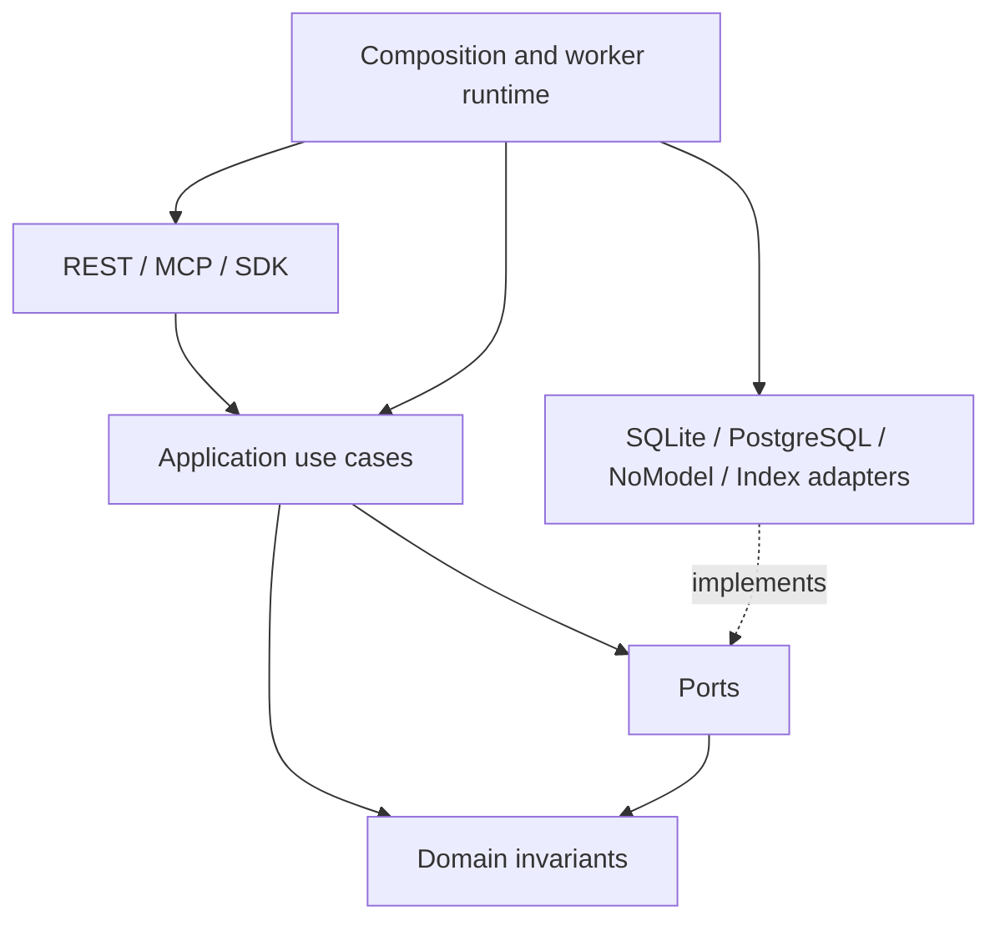

# P0-Baseline-001 架构

目标：独立长期记忆基础设施；优先 AI 类似体，再扩展编程 Agent、助理与团队。未给定已有六层名称，本基线明确如下六层；后续名称调整须保持依赖方向并附 ADR。

| 层 | 职责 | 可依赖 |
|---|---|---|
| L1 接入 | REST、MCP、Python/TS SDK 协议转换 | L2，公开 DTO |
| L2 应用 | 用例编排、鉴权、事务、幂等、删除协调 | L3、L4 |
| L3 领域 | 实体、不变量、状态转换、冲突规则 | 语言标准库 |
| L4 Ports | UoW、Repository、Policy、Clock、PayloadStore、Model、Index、KeyVault、Audit | L3 的值类型 |
| L5 Adapters | SQLite/PostgreSQL、无模型、检索、密钥和文件存储 | L4、外部库 |
| L6 运行装配 | 配置、进程、任务执行、迁移、诊断 | L1/L2/L5 |

层号不是单向逐层调用链；内核为 L3+L4，L4 声明外部能力，L2 编排，L5 实现接口，L6 注入。持久化 DTO 不能渗入领域对象。

核心 Ports：UoW.run(transaction)、MemoryRepository.get/cas_append、EventRepository.append、EvidenceRepository.resolve、Policy.authorize/classify、Idempotency.reserve、Outbox.claim/ack、PayloadStore.publish_ciphertext/erase、KeyVault.readiness/allocate/lookup_intent/seal/open/revoke/verify、Index.upsert/delete、Clock.now。签名必须携带服务端 AuthContext、tenant_id、deadline；返回明确的 NotFound/Conflict/Denied/RetryableFailure。跨租户查找不能提供不带 tenant 的仓储方法。所有业务持久写仅经同一 UoW；外部调用在事务外。

无模型模式仍支持人工附证写入、版本读取、时间过滤和确定性词法检索；提取服务关闭时返回 capability unavailable，不伪造推断或 embedding。模型输出是待验证候选，不能独立决定权限或覆盖事实。

事件记录逻辑不可变；全部生产内容置于安全 backend 加密的可擦除 Payload；删除保留最小无内容审计信封而非保留可逆明文。删除与不可变冲突的取舍见 ADR-003。

扩展：REST 与 MCP 调用同一用例；SDK 从契约生成但不共享授权实现。索引、模型与队列均可替换，数据库为权威，索引为可丢弃派生物。尚无性能、安全认证或生产实现。

验证：后续引擎以依赖扫描禁止 L3/L4 导入 adapters/web/provider；两个后端跑同一端口契约；当前检查对应 P0_ACCEPTANCE。

P0-SC 不改变六层或授权根。删除操作/范围及源失效投影见 [ADR-010](adr/010-deletion-scope-boundary.md)，分类与 KeyVault/staging 前置条件见 [ADR-011](adr/011-payload-protection.md)。新增 Ports 方法是契约目标，无生产 adapter；外部 key/密文操作仍在 T1 外，UoW 保存补偿/关联元数据。
