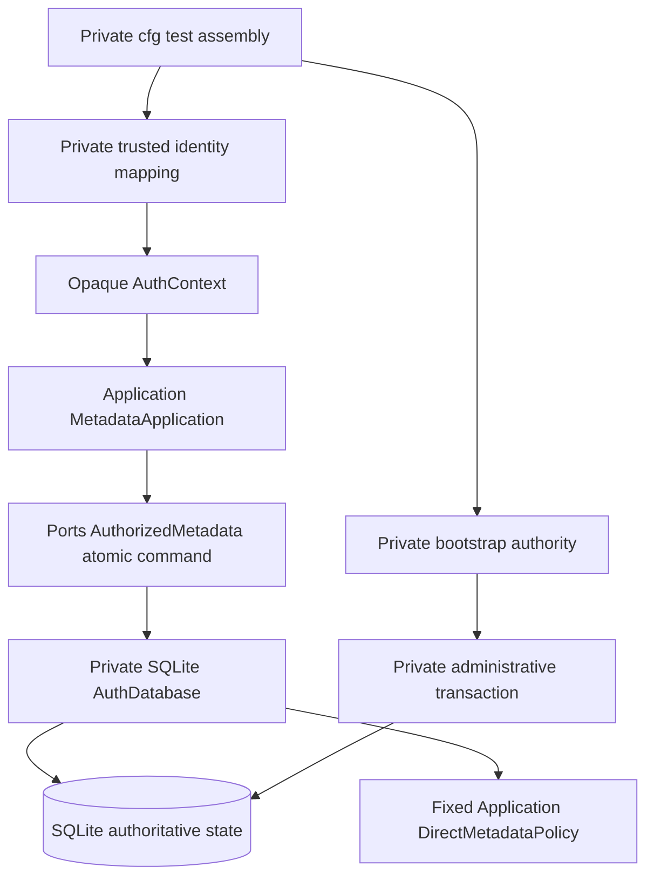

# P1 Auth Foundation — trusted test assembly and transactional direct policy

This is an isolated, no-content local engineering prototype. It implements and tests real SQLite
policy behavior; no public authentication, production identity issuer or content service is active.
Auth Foundation review baseline: 9e3e44225c82e2afcb85f7d745783e03125fa10e. R1 side channel
remediation is defined by AUTH_ADR_002; no independent R1 PASS is asserted.
ADR AUTH-001 defines compatibility deltas BEFORE this implementation. No production P0 promises
are replaced by this synthetic test profile. No remote, public branch, PR or license change.

## Modules and trust



Domain remains database/OS/model independent; Ports and Application depend only on domain/Ports.
SQLite's test adapter uses Application via an existing dev-dependency. No new registry version is introduced; existing getrandom 0.4.3 is now a direct test dependency.
Public facade assembly is an infrastructure composition operation; no production composition root
accepts a request-selected Store or Policy. A fake external Port implementation can fake its own
result, but cannot acquire the real private backend or its Context. Backend fields, raw connection,
constructors, administrative methods and identity issuer are private, not exports or test features.
`cfg(test)` is not activated in a dependency by Cargo feature unification or --all-features.
The fixture does not test a network credential: TrustedIdentity is a key accepted ONLY from this
protected test assembly. No boolean broker proof, requested admin/owner or raw Principal ID is proof.

Old ports::AuthContext/BootstrapAuthority stay unconstructible, inert compatibility markers for
NoContentRuntime; they are not convertible to the backend-associated opaque identity. This avoids
adding a public privileged constructor solely to bridge crates. Consolidating them for an actual
production identity issuer needs separate review. All new trusted constructors remain unavailable
outside the Rust unit-test harness, even when a caller enables both existing lab features.
The lab stays explicitly experimental. It cannot open Auth v3 as a v1 store or be injected into
NoContentRuntime. OS principals with arbitrary file/code writes remain outside API encapsulation.

## Identity and management

The server-side SELECT maps subject -> Tenant/Principal and verifies active binding, active tenant,
active principal, existing same-tenant Space and enabled auth_space. Target Space is a selector only.
AuthContext's private fields: realm, subject, principal, scope, tenant_epoch, space_epoch, issued_at.
No embedded Grant or admin flag; Clone copies observations, not durable authorization. No serializer,
public constructor or conversion from claims exists. The realm prevents contexts from another DB
instance with coincidentally equal tenant/principal/epoch values being accepted. Restored/cloned
backups retaining the same realm are NOT protected from rollback by this mechanism.

Bootstrap starts only in an empty realm/tenant DB. Private BootstrapAuthority is independently
issued, bound to the realm, and never accepted by an ordinary marker command. Tenant initialization,
first principal/binding, new personal Space, direct Grant change and state changes use this private
administrative path. They execute BEGIN IMMEDIATE, validate authority, mutate, increment tenant
Auth epoch (and affected Space policy epoch), append an immutable minimal auth audit and COMMIT.
Failure at any stage rolls back all rows/epoch/audit, including partial bootstrap inserts.
The test-only authority does not implement production admin login, persistence, recovery or approval.

Supported Grant is exactly metadata.append for a direct same-Tenant principal and Space, with
strict expires_at_ms and enabled state. Unsupported capability/group inheritance is denied, not
inferred from ownership, admin claims, P0 role matrices or Group existence. Tenant, principal,
binding and Space disablement invalidate requests. Re-enabling never revives an old context because
epochs only advance. Grant changes conservatively invalidate all contexts in the affected tenant.
There is no grant-cache decision to bypass current state. Tenant-wide invalidation is intentional
for a small first kernel; a future finer epoch scheme must preserve this rejection behavior.

## Atomic application command

MarkerWrite contains Scope, target=Create or Existing(marker), expected CAS version, idempotency
key and enum capability. Create contains NO marker/event ID. Existing is a scoped update reference,
not a new ID assignment. No body, classification, claimed actor, owner, administrator, event or
ID-generator field exists. MetadataReceipt returns the server-created marker and event IDs.
Success creates a synthetic system_action Event with NULL payload, marker version, retry receipt,
commit_record, metadata audit and pending metadata Outbox row. It does not create valid Memory,
Revision, Evidence or content Payload. These are intentionally not content grants.

1. BEGIN IMMEDIATE on the authoritative SQLite connection (5-second busy timeout).
2. Sample trusted server Clock; validate live realm, scope, binding/principal/tenant/Space states,
   matching context epochs, direct capability, enabled flag and expires_at_ms > now.
3. Look up (tenant, principal, operation implicitly fixed, idempotency key). Matching digest returns
   the same receipt ONLY after authorization; mismatched digest returns IdempotencyConflict.
4. Otherwise Create requires expected_version=0, generates a new marker ID and event ID from OS
   randomness (UUIDv4), silently retrying internal collisions up to 8 candidates per ID. Existing
   queries tenant+Space+id; foreign and absent targets have the SAME AuthorizationDenied result
   before comparing CAS version. Every new event is server-generated. Allocate knowledge_seq,
   append Event, perform CAS and persist receipt, audit and Outbox atomically. Any failure rolls back.
   Replay uses stored marker+event IDs before calling the generator, including after response loss.
   Generated IDs are not Create digest inputs. Entropy failure/collision exhaustion share a generic
   ResourceUnavailable with no candidates, counts, object kinds, Space or SQL details exposed.
5. Re-sample server time and revalidate policy before COMMIT, including replays. Clock errors or
   backward motion within the command reject. Return success only after a successful COMMIT.

No externally usable raw transaction or commit callback crosses the application boundary. Private
before_commit hooks are barriers in this test-only adapter, used to schedule real SQLite races.
Application has no caller-injected Policy parameter; the adapter uses fixed DirectMetadataPolicy.
Policy observation structs are plain data, not security capabilities; only live trusted DB reads
inside this adapter may supply them for actual writes. Receipts cannot be converted into authority.

## Linearization and evidence

Administration and writes contend for SQLite's real BEGIN IMMEDIATE lock, including across
processes. If a writer already holds the lock and passes policy, its commit may precede concurrent
revocation. If revocation/disable commits first, queued or later requests fail live state/epoch
checks; they cannot replay an old receipt as authorization. No in-process gate is used as evidence.
Authorization expiration is defined at the last server policy sample under the held write lock,
not wall time at the physical COMMIT instruction. This follows P0 recorded_at's non-physical-time
semantics. Sustained contention returns Busy; it never relaxes Policy. No automatic semantic retry.

Tests cover both grant-revoke/write orders, disable/write, grant-add/write, same-version competing
CAS, same-key competing replay and expiry after provisional writes. The cross-process test issues
an old context before revocation, holds a real admin write transaction, makes a child observe
SQLITE_BUSY with a short real timeout, then commits revocation; the child's normal queued command
is denied and knowledge_seq remains 0. This is an actual second process and SQLite file, not mock.
It does not prove correctness on another filesystem, across hosts, backups or arbitrary OS attackers.

## Schema, time and acceptance limits

Fresh v3 composes unchanged Foundation/0002_auth_profile.sql plus 0003_auth_r1.sql and stores a
combined checksum. The latter extends receipts with marker_id and adds a redundant scoped unique
index to enforce the same-Space receipt FK; all tenant/id PK identities stay unchanged. Expected definitions come from compiled code, never the DB manifest. Full object and
interpreted-constraint attestation, integrity_check and foreign_key_check run inside startup's
IMMEDIATE transaction; foreign_keys=ON and WAL are checked per connection. v1/v2 are refused, not
silently migrated. The v1 Foundation attestation entry and all its counterexamples still run.
There is no generic migration/repair tool or validated production import path in this release.

Clock is an injected infrastructure Port from trusted TEST assembly; tests control time to reproduce
expiry deterministically and perform real DB mutations. Network credentials, trusted wall-clock
operation, clock rollback across restart and protected epoch/backup witnesses remain unaccepted.
SHA256 digests cover only synthetic opaque commands here; production HMAC/key and 30-day retention
requirements are NOT implemented. Audit is a local minimal append-only ledger, not production
administrator attribution, denied-request telemetry or tamper-proof storage. Outbox rows have no
worker/lease execution. Admin authorization state orders by epoch, independently of Event knowledge
sequence; current authorization is always applied, including to historical/replayed results.

No public OAuth, REST, MCP, real user identity, complete Group model, encrypted content, KeyVault,
SecurityWitness, deletion coordinator, irreversible erase, backup anti-rollback or D: deployment
acceptance is claimed. NoContentRuntime still refuses all content classes and NoModel operations.
Read/export/history/search endpoints are absent and confer no implemented permission.

## Reproduce

Use C: NTFS source and build/temp/cache directories with enough free space. Never clean unknown
files or reuse D: exFAT for SQLite acceptance. In this machine's prepared environment:

```powershell
. ./scripts/enter-toolchain.ps1 -BuildRoot <C-cache> -ToolRoot D:/YixuMemory/work/p1-tooling
cargo fmt --all --check
cargo clippy --workspace --all-targets --all-features --locked -- -D warnings
cargo clippy --workspace --all-targets --no-default-features --locked -- -D warnings
cargo test --workspace --all-targets --all-features --locked
cargo test --workspace --no-default-features --locked
cargo test --workspace --doc --all-features --locked
python scripts/check_surface.py
```

Python 611 regression runs against a fresh C: copy of public main 85f033e..., with bytecode writes
disabled and caches on C:. No D: source, license, tag, public branch or authorization PR is modified.


## R1 acceptance boundary

The former caller-selected marker/event creation API is removed, not retained as an adapter or
hidden overload. Scope-constrained update references still exist for CAS; they cannot create an
absent marker and must produce the same result for foreign and absent IDs. All request paths use
the same MarkerWrite type. No network DTO/JSON endpoint is implemented, so no HTTP parser acceptance
is claimed; future transports must preserve this contract and not introduce allocation fields.

The private ResourceIds seam exists only inside cfg(test) Auth assembly and cannot be imported via
feature unification/all-features. Production NoContentRuntime still refuses content. UUID entropy
uses getrandom's OS source; UUID masks implement the RFC layout, not a new cryptographic algorithm.
Tests cover shape/OS calls, not entropy quality or impossibility of collisions. Global timing and
traffic side channels are not claimed eliminated. This fixes the verified chosen-ID outcome oracle.

Controlled-path input inventory: Scope is checked against opaque identity before mutations;
capability is allow-listed; expected_version is numeric and checked within the authorized Space;
idempotency PK is (tenant,principal,key), not global, and cross-principal key reuse is tested to
return only the requester's own generated resources; Existing(marker) is only a scoped reference.
No other caller-supplied tenant-global UNIQUE allocation value remains in this active path.
Bootstrap/experimental lab identifiers are privileged/isolated paths, not this request ingress.

Revocation/write races retain CONDITIONAL PASS only: final-clock-sample cutoff semantics, true
Auth crash windows and production clock/backup protection are NOT resolved by this R1 change.
Foundation crash regressions are not evidence of Auth's unexecuted crash windows. Group, public
identity issuance, production content/KeyVault/deletion/recovery and licensing gates stay closed.
