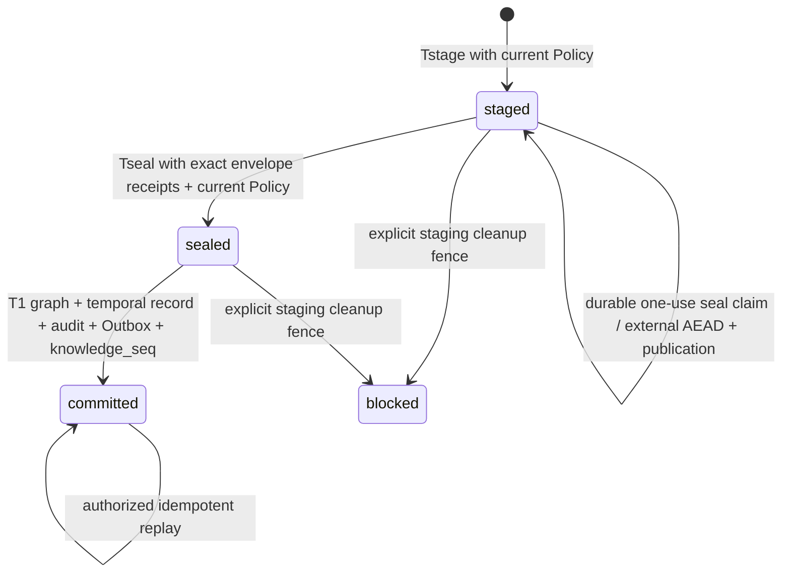

# M3-B synthetic persistence engineering — 2026-11-02

Status: isolated local test prototype, not production admission. Base c0150fe9334364777bbfe91f192d8635fc49817d.

## Accepted scope and new Profile

Fresh Profile 6 composes the existing Foundation/Auth/M1/M2 schema plus a compiled, checksummed extension. Existing Profile 1–5 files are refused, never automatically migrated. Startup schema comparison and foreign_keys verification remain mandatory. The original migration files are unchanged. Profile 6 is reachable only through Rust unit-test compilation. Its available payloads and active memories are synthetic objects, never production service capabilities.

Tstage stores generated Event/Evidence/Memory/Revision IDs, principal-scoped request digest, four immutable payload/key bindings and seal generation. Caller cannot choose resource IDs. The request digest includes server scope, target/CAS and synthetic content variant, excludes generated IDs. Synthetic variant selects one of two fixed canary bodies (42/43); no arbitrary bytes input exists.

Each copy's attempted flag commits BEFORE encryption. A process dying after the claim but before a complete ciphertext becomes visible leaves UNKNOWN: no reseal of that key/generation, no inferred success, no silent replacement. A staged complete ciphertext is verified by envelope/AAD/tag before Tseal; recovery and Tseal both require attempted=1 and exactly four matching bindings/receipts. A valid copied envelope without a prior durable attempt is rejected. Tseal stores the digest. Tseal and T1 revalidate authorization. Files and crypto are outside SQLite write transactions. T1 atomically publishes all four Payloads, Event, Evidence, Memory, Revision, RevisionEvidence, revision_time, current_revision/CAS, payload/key copy_manifest (test-key references, not erasure evidence), audit, Outbox, commit_record and knowledge_seq. Rollback preserves sealed staging intent but no partially visible business facts.

There is no complete production SecurityWitness/Tguard coordinator in this extension. Profile 6 refuses any recorded deletion or invalidation in the Space; the final release gate also checks active Memory state. Existing Profile 5 Conflict/time/pagination code is preserved and regression tested; Profile 6 does not add content time-query, search, conflict-resolution or deletion APIs.

## Crypto, memory and release

AEAD is the pinned RustCrypto XChaCha20-Poly1305 implementation used by M3. AAD is the accepted fixed-width 163-byte encoding including scope, typed owner, payload/key identity, seal generation and protection digest. Envelope: 8-byte YIXUB001, u32BE length, AAD, nonce24, tag16, ciphertext. Strict synthetic body bound and exact lengths checked before decryption. Private locked buffer uses the accepted VirtualAlloc/VirtualLock/zeroize primitive with the same dump/register/VM limitations. The small unsafe exception is test-only; crate default remains deny and normal production code has no unsafe exemption.

TEST KEYS ARE PUBLICLY DERIVABLE FROM RANDOM KEY IDS. This permits isolated child-process recovery experiments WITHOUT pretending to implement durable secure KeyVault. It has no secrecy/revocation/backup guarantee and is entirely cfg(test), not an exported backend. The two CANARY bodies are fixed synthetic content. Never place real content in this profile. NoContentRuntime remains incapable of content write/read and normal/all-features dependency graphs exclude test crypto.

Read performs authorization in a short SQLite transaction, validates files/decrypts into locked pages outside that transaction, then acquires a final writer transaction to recheck current auth epochs/grants/expiry, fences and current Revision/Memory state before releasing ONLY a digest into a synthetic in-process sink. This is not a production ReleaseAuthority or socket output proof. No raw ciphertext-to-plaintext public API is introduced.

## Filesystem distinction

Windows Store is intentionally only an OS-owned fresh TempDir test harness: create_new, bounded reads, exact Envelope and hash, file sync. It does NOT prove safe named atomic publication, directory persistence, hostile reparse-point safety or physical power-loss durability. Partial named writes are rejected; unknown results retain staging intent.

Linux `m3-lab/src/linux_store.rs` is reference source compiled only in Linux unit tests. It consumes a trusted directory File anchor, validates euid/mode0700/type/device, uses openat2 BENEATH|NO_SYMLINKS|NO_MAGICLINKS|NO_XDEV, verifies regular file/euid/mode0600/device/nlink, writes ciphertext only, fsync(file), renameat2 NOREPLACE, fsync(directory). Unsupported syscall/filesystem or any fsync failure fails closed; post-rename fsync error is UNKNOWN, requiring reconciliation. Caller paths cannot enter object names (fixed hex identity). Known cleanup uses the same anchor and exact bytes. No symlink or path-string fallback exists. The anchor must itself be securely provisioned by a future broker; same-euid/root/mount-admin compromise is outside this reference. No validated Linux runtime is available here: this source and its Linux tests remain UNCOMPILED/UNEXECUTED, and are NOT integrated into the Windows SQLite loop.

References checked: [openat2](https://man7.org/linux/man-pages/man2/openat2.2.html), [fsync](https://man7.org/linux/man-pages/man2/fsync.2.html), [link/relative paths](https://man7.org/linux/man-pages/man2/linkat.2.html). Directory persistence is separately required by fsync semantics. Implementation uses existing pinned rustix 1.1.6, not copied third-party code.

## Recovery matrix

| Boundary | Evidence and recovery | Tested level |
|---|---|---|
| Tstage committed | resume stored IDs; unused copies may seal | SQLite + external process kill |
| seal attempt claimed, file missing | reject UNKNOWN, explicit fence/cleanup/new intent needed | SQLite test |
| publication complete / Tseal absent | verify all existing ciphertexts, persist receipts, T1 | SQLite + file reopen + process kill |
| Tseal committed / T1 absent | exact digest/AAD/tag verification then new authorized T1 | SQLite + process kill |
| T1 uncommitted | SQLite rollback, no fact/Outbox/sequence; reuse sealed intent | process killed with transaction open |
| T1 committed / reply absent | current authorization before same receipt; one graph only | process kill + idempotency |
| partial/corrupt/missing file | reject; never claim readable success | file tamper/reopen tests |
| orphan ciphertext | inventory separately; explicit intent fence then cleanup known valid copies | Windows test harness only |
| unknown filename/malformed object | retain and report; never delete guessed data | preservation tests |
| ENOSPC/short-write/fsync error | no readable fact; retain ambiguous staging | SIMULATED error injection |
| concurrent CAS | one successful revision; loser sealed intent retained | two real SQLite connections |
| same key multiprocess | retries converge to one committed fact | two child processes |

Explicit cleanup is NOT erasure completion or secure key revocation. Corrupt copies stop cleanup, unknown files stay untouched. No automatic orphan deletion is allowed. Restart tests close/reopen databases and real process tests terminate a child with OS kill at a signaled checkpoint, not just returned errors. None simulates physical power failure.

## Remaining gates and next implementation

1. Run and compile Linux adapter on verified Linux filesystem; exercise parent rename, symlink/hardlink, mount and ACL attacks, actual short-write/ENOSPC/fsync error propagation, orphan inventory reconciliation and no-replace concurrent publication. Integrate Linux store with SQLite only after those pass.
2. Build trusted Local KeyVault with non-derivable DEKs, bounded locked lifecycle, independent key storage, restart sealing and no resurrection; offline usability retained. Real Local backups still fail closed without verified recovery path; no whole-machine rollback deletion claim.
3. Protected requires authenticated independent-domain Witness and current ReleaseAuthority; unknown/unavailable/mismatch rejects without Local downgrade. No production Protected path is supplied here.
4. Real transactional source graph deletion, generation receipts, cross-service intent recovery and output release still require separate implementation. No key reuse/revocation or old backup safety inferred from tests.
5. SQLite file/WAL/TEMP/log/backup confidentiality scan covers fixed canary only; crash dumps, physical power failure, malicious same-OS-principal and filesystem corruption remain outside this acceptance.

No public push, release, license change, production data, old Profile rewrite, cache cleanup or D: database runtime.
