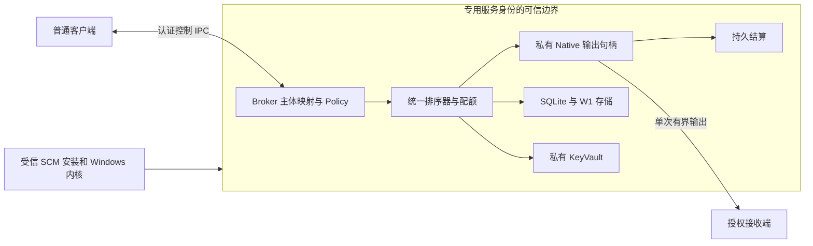

# ADR-M3-008 Windows 服务身份与唯一输出所有者

2026-11-10。架构方向已由项目所有者批准。部署与安全验收待定。基线 `df63cfa4830aaf44a4490eba5d59b664bdb5c304`。

采用独立低权限 Windows 服务身份承载单实例 Native Broker。普通应用使用经过双向认证的本机 IPC。首选虚拟服务账户 `NT SERVICE\YixuMemoryBroker`。部署必须分别检查实际 TokenUser、服务 SID 与组属性、Session、权限集合和 Profile 能力。Service SID 是访问控制标识，加入它不改变既有 DPAPI 用户身份。独立进程运行，拒绝 LocalSystem、共享 LocalService 冒充独立用户，以及静默降级到当前用户。虚拟账户的 Profile、DPAPI 与无人登录启动待原生验证。

| 边界 | 契约与验收 |
|---|---|
| 进程与线程 | 安全描述符从创建和启动时即受保护。普通客户端无 DUP_HANDLE、VM_READ/WRITE/OPERATION、CREATE_THREAD、SUSPEND_RESUME、SET_CONTEXT、WRITE_DAC、WRITE_OWNER 等能力。单独验证 process 和 thread 对象及 owner，不用服务对象的 ACL 代替。启动后才收紧 ACL 不能覆盖启动窗口。 |
| Token | 普通客户端无法复制、模拟、调整或替换服务 Token。若实现服务端验证只需身份级模拟，避免授予更高模拟权限。最低必要查询权按实际认证机制验收。 |
| SCM 与安装文件 | 管理权限与运行权限分离。普通客户端不能改变服务二进制路径、启动账户、配置或 DACL。保护 EXE、DLL 搜索路径、配置、信任根及全部可替换的父目录。使用绝对路径，关闭用户可写插件、工作目录或 PATH 搜索。 |
| 数据与 Vault | 权威 SQLite（含 WAL/SHM）、Vault、密文和恢复记录仅归可信身份，沿用 W1 句柄/NTFS 边界。既检查文件自身也检查父目录 delete-child、rename、reparse 等绕过。普通应用无数据库连接或 DEK。 |
| 句柄 | Broker 独占 server、Event、OVERLAPPED、缓冲及锁。默认零继承。如确需启动子进程，仅精确列举允许的句柄。非继承不能阻止 DuplicateHandle。客户端拥有 reader，允许其持有副本的现实必须进入预算和故障模型。 |
| 配额 | realm 唯一权威覆盖所有进程、会话及客户端。活动写上限 1，正文队列 0，元数据等待上限 16，单次正文 4096 字节、元数据 512 字节，连接仅一次正文尝试。首次服务验收以单 realm、单正文连接为上限，包含已断开但未证明可退账的连接。控制连接另设固定上限，实际阈值随 IPC 容量验收固定。超限拒绝，不能换实例、数据库或管道名继续授权写。 |

IPC 用独立本地控制通道和一次性正文通道。显式最小 DACL、拒绝远端、首实例与服务端生成连接标识。客户端申请精确访问权，避免通过泛化写权限授予 FILE_CREATE_PIPE_INSTANCE。控制通道先验证双方，客户端从受保护的安装信任根认证服务，服务从实际管道端对端上下文校验 OS 主体并映射独立应用 Principal 和实时 Grant。相同用户 SID 不能证明某个应用二进制的身份。模拟若用于取身份，必须检查成功并恢复服务身份后才做 Vault 或业务操作，恢复失败关闭会话并阻断该执行路径。

两条通道的认证必须绑定实际连接、realm、incarnation、Principal、request digest、一次性 connection ID、方向及期限。复制 PID、端点名、证明或控制通道票据到另一条连接须拒绝。需要用成熟的认证机制提供新鲜握手及可验证的通道绑定。协议适配器及其 wire 预算在 S2 定版，须先通过假端点、跨连接转发与同 SID 不同应用主体的反例。仅凭 DACL、PID 或 nonce 回显不满足认证契约。正文通道认证前不解封、不发送正文；不能认证正文通道就保留 CapabilityUnavailable。管理员接口使用单独权限，普通 IPC 不提供句柄、路径、密钥或恢复控制权。

安装与升级需要一次管理员同意。日常操作由普通用户通过授权 IPC 完成，Local 全程可离线。卸载与数据销毁分别授权。当前用户宿主可用于弱保障合成实验，AppContainer 可作为后续客户端限制。两者不替代服务级隔离或恢复证据。管理员、内核、受信部署篡改及完整系统快照超出 Local 保障。进程锁、Job、PID、心跳及租约仅作为运行辅助。

验证见 [S1 实验手册](M3_W4A2_R2_S1_PLAN.md)。正式启用前按部署身份实测有效访问和拒绝。优先用专用虚拟账户，若身份或 Profile 不成立则阻断该装配。未来备选专用本地账户需另审生命周期与凭据成本。

依据 [SERVICE_SID_INFO](https://learn.microsoft.com/en-us/windows/win32/api/winsvc/ns-winsvc-service_sid_info)、[服务权限](https://learn.microsoft.com/en-us/windows/win32/services/service-security-and-access-rights)、[进程权限](https://learn.microsoft.com/en-us/windows/win32/procthread/process-security-and-access-rights)、[命名管道权限](https://learn.microsoft.com/en-us/windows/win32/ipc/named-pipe-security-and-access-rights)。
