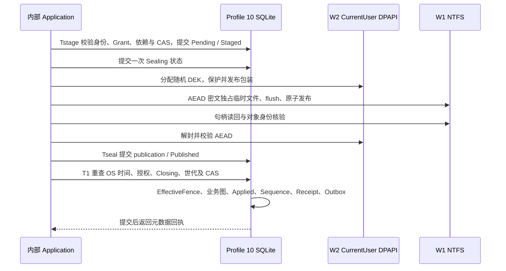
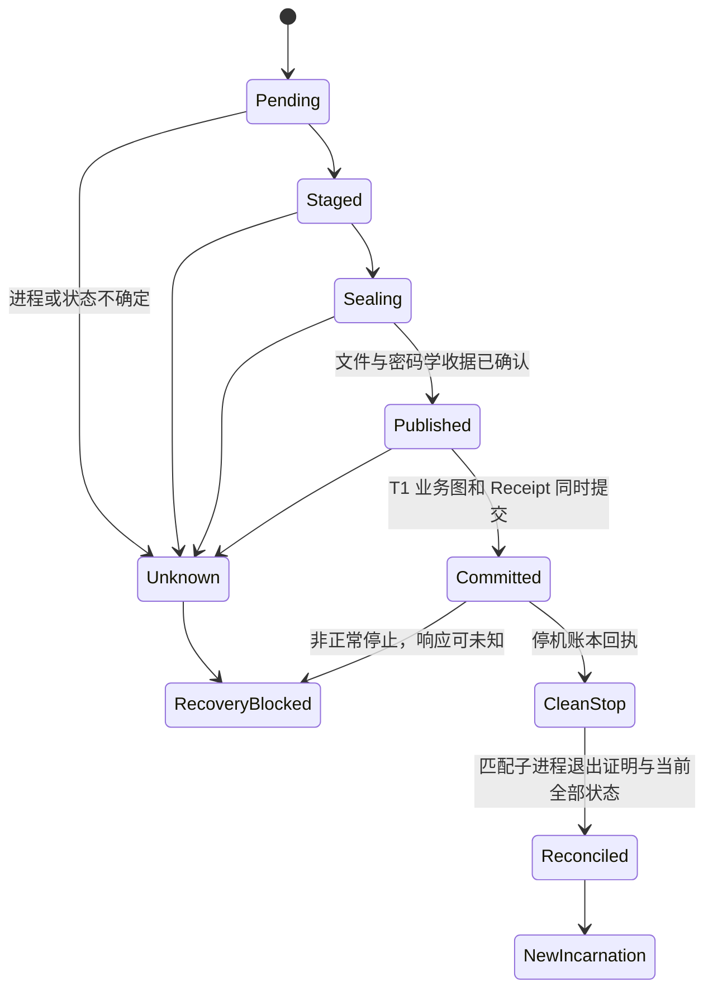

# R6-B1 实施报告

2026-11-19，Windows x64 / C 盘 NTFS 内部实验。整体 R6 为 **NOT READY**。

## 基线与交付位置

开始时 HEAD 是 `6e4139d63362b8a69011b277250848270a45037e`，父提交为 `0b489e0de53cbf2ef3786e88b58d318778e7cd92`。分支为 `local/p1-m3-w4a-r6-local-content-engine`，暂存区为空。只读核对了 git status、完整 diff、cached diff、未跟踪文件以及已有 R6 五个修改文件。已有 AEAD、检查脚本和两份调研／进度文档纳入本次成果。

按私有 README 指向的公开基线读取了 AGENTS.md、SYNC_POLICY.md。用户指定的本地分支与本地提交范围覆盖其默认同步流程。公开 main、LICENSE、标签及 PR #2/#5 不在变更集合中。

完整 DDL 位于 [0010_local_content.sql](../crates/sqlite/migrations/0010_local_content.sql)，内部 Application 接口位于 [internal_content.rs](../crates/application/src/internal_content.rs)。设计与兼容边界见 [ADR-M3-014](M3_ADR_014_PROFILE10_CONTENT_WRITE.md)。

## 实际写入链路




业务请求绑定 Tenant、Space、Principal、Memory、Revision、Evidence、Request ID 和 Payload Generation。正文是实际传入的 UTF-8，测试同时使用每次运行生成的随机多字节哨兵和不同长度文本。初始版本编号为 1，B1 对已有 Memory 或非空 expected_current 返回 CAS 冲突。Revision、Key 元数据、密文收据、Receipt 和 Outbox 具有不可变约束。

当前写入范围为每 Payload 1 至 4096 UTF-8 字节，超长及空正文明确拒绝。API 返回对象 ID、Revision 和 Knowledge Sequence。正文、标题或明文摘要未进入 SQLite。

## 状态与恢复



对账分别报告 PendingNotStarted、IntentEstablished、PublicationUnknown、PublicationConfirmed、OutputUnknown、CommittedReceipt、CommittedReceiptResponseUnknown、CiphertextMissingOrUnavailable、IntegrityRejected、KeyUnavailable、SecurityStateDenied 与 UnregisteredStorageObjects。安全状态拒绝与文件损坏有独立含义。

创建先用 W1 枚举根命名空间，拒绝旧 WAL、SHM、数据库及未知根条目，同时要求 payloads 和 keys 为空。恢复验证根、密文目录及密钥目录的对象身份，拒绝未登记对象。control 和 temp 是隔离测试宿主的诊断／临时目录，正文路径不会写入它们。未确认对象及崩溃测试目录被保留，禁止自动清理或重新封装。

正常重启的证明绑定该次受控启动的 Child HANDLE、安装／Realm、启动 nonce、incarnation、持久停机账本和一次性恢复回执。单独的历史 clean 标志、锁释放或任意进程退出都不足以接管。恢复过程进行真实 SQLite 重开、NTFS 重新读取、DPAPI 解封和 AEAD 验证。测试覆盖一次受控子进程退出后的恢复与新写入，未覆盖连续多轮 owner 交接及重复停机／恢复链。B1 不返回明文给 HTTP、IPC、CLI 或日志。

## 崩溃与故障矩阵

| 边界或故障 | 实际断言 |
|---|---|
| Pending / Staged 后终止 | 保留一个 Intent，业务图和 Receipt 均为零，阻断重放。 |
| 包装发布后终止 | DPAPI 文件保留，密文尚未被证实，保持阻断。 |
| 密文发布后终止 | 文件存在不能代替 publication 或业务提交证据。 |
| Tseal 后终止 | Published 可诊断，业务图及 Receipt 未创建。 |
| T1 事务内部终止 | SQLite 撤销未提交图、安全事件、Receipt 和 Outbox。 |
| T1 提交后终止 | 一个已提交图和 Receipt 可验证，响应未知，缺少干净停机证据仍阻断接管。 |
| 干净停机、实际退出、新实例 | 验证停机回执、存储与密钥后记录新 incarnation，允许新授权写入。 |
| 相同 Request ID | 同 scope、Principal、元数据和实际字节返回原回执。错配正文或元数据拒绝。 |
| 不同 scope / Principal | Request ID 独立。跨身份请求不能取得他人回执。 |
| 重用 Key ID / Payload | SQLite 唯一约束拒绝，真实不同 Payload 使用不同随机 DEK。 |
| CAS、无效 Evidence、旧 Generation | 发布前拒绝，保留正确当前版本。 |
| Grant 过期或撤销、Tseal 后 Closing | T1 前重查，事务不发布业务图及 Receipt。OS 时钟过期在写入中测试。 |
| DPAPI 保护边界失败 | 注入拒绝，未生成替代密钥或成功业务记录。真实 CurrentUser 成功及损坏包装拒绝另有实际 OS 调用覆盖。 |
| 短写和 no-replace 冲突 | W1 真实文件操作加受控故障，保留证据并阻断。未模拟物理介质故障。 |
| 密文缺失、篡改、同字节替换身份 | 分别按缺失或完整性错误拒绝恢复。 |
| 包装损坏或缺失 | 不能解封或核验时拒绝，KeyUnavailable 独立报告。 |
| 无关 Child 证明、错配实例或停机后账本变化 | 恢复拒绝。 |

## 正文泄漏扫描

运行时生成随机 UTF-8 哨兵，不将哨兵本身或可恢复的完整正文写入证据清单。逐字节检查 UTF-8 及对应 UTF-16LE。扫描覆盖 SQLite 主库、存在时的 WAL/SHM、TEMP、control 中的子进程 stdout/stderr 日志、文件名、密钥包装、密文及目录内其他文件。活跃独占锁通过其拥有的 HANDLE 验证长度为零，关闭后再次读取检查。

扫描还覆盖七个真实进程终止点及正常子进程重启。输出仅含阶段、扫描文件／字节数和零匹配结果。全部记录在 `verification/r6-b1` 的详细测试日志。受控测试目录保留在 `verification/r6-b1/owned-test-roots`。

## 验证与限制

| 结论 | 已执行检查 |
|---|---|
| PASS | Rust default 共 386 项，含 375 项业务／回归用例与 11 个辅助进程入口。 |
| PASS | Rust all-features 共 388 项，含 377 项业务／回归用例与 11 个辅助进程入口。 |
| PASS | doctest 10 项，独立计数。B1 专项 17 项，其中 16 项业务用例与 1 个辅助子进程入口。 |
| PASS | fmt，Clippy `-D warnings`，50 个外部编译拒绝探针和 4 个包依赖图检查。 |
| PASS | Python 公开基线 611 项，私有 Schema／契约 51 项，新增 Python 测试 Ruff。 |
| PASS | 私有源码与凭据模式扫描，公开跟踪源码 110 个路径扫描。Rust 精确锁定的 59 个 registry 包经 OSV 查询未返回已知公告。此结论限定于该 Rust 清单。 |
| PASS | 正常写入、实际子进程退出及重开、七个强制终止边界、文件篡改／缺失、包装损坏／缺失及 UTF-8／UTF-16LE 哨兵扫描。 |
| CONDITIONAL | B1 验证使用内部宿主预置的身份与 Grant。R4/R5 复用范围见 ADR，生产登录和完整派发／释放装配留待独立验收。 |
| NOT TESTED | 指定 Luna High 模型签核、物理断电、完整本地快照回滚、OS 时钟回拨和其他平台。 |
| NOT READY | 整个 R6 的读取、修订、历史版本读取、删除闭包和生产正文入口。 |

准确测试汇总、源文件与日志 SHA-256 清单、Git 证明保存在 `verification/r6-b1`。辅助进程入口与业务回归用例分开统计，doctest 单独计数。源码默认编译图仍通过外部导入拒绝和依赖隔离检查。

独立审查已推动修复证明错配、存储新建边界、请求时钟、停机与当前读取资格混淆等问题。审查记录见 [B1 独立审查](M3_R6_B1_INDEPENDENT_REVIEW.md)。指定 Luna High 的模型身份无法在当前会话核验，因此该项单独列为 NOT TESTED，不能代替发布签核。

Windows x64 NTFS 的 B1 功能测试属于本地实验验证。生产正文入口、授权登录装配、原生释放、Service 身份、跨机器迁移、Protected Witness、强擦除、物理断电及其他平台均未在 B1 验收。OS wall-clock 调整与整个本地回滚域恢复不能由当前 DPAPI／SQLite 独立检测。后续读取、修订、历史读取和完整删除闭环属于 B2/B3。

## 精确修改文件清单

以下相对路径共 19 个，包含保留的首次 R6 未提交成果。

```text
crates/application/src/internal_content.rs
crates/ipc/src/tests/r4.rs
crates/ipc/src/tests/r4/r5.rs
crates/ipc/src/tests/transaction_gates.rs
crates/sqlite/migrations/0010_local_content.sql
crates/sqlite/src/auth/persistence.rs
crates/sqlite/src/auth/persistence/content_crypto.rs
crates/sqlite/src/auth/persistence/profile10.rs
crates/sqlite/src/auth/persistence/profile10/recovery.rs
crates/sqlite/src/auth/persistence/profile10/tests.rs
crates/sqlite/src/auth/persistence/profile10/write.rs
crates/sqlite/src/auth/persistence/winfs.rs
docs/M3_ADR_014_PROFILE10_CONTENT_WRITE.md
docs/M3_R6_B1_INDEPENDENT_REVIEW.md
docs/M3_R6_B1_PROFILE10_WRITE.md
docs/M3_R6_LOCAL_CONTENT_ENGINE.md
docs/M3_R6_OPEN_SOURCE_REFERENCES.md
scripts/check_surface.py
tests/test_profile10_contract.py
```

最终 Git SHA、分支、R5 分支指针、父提交、工作区和受保护路径 diff 记录在本地 `verification/r6-b1/git-commit.json`。验证日志和含密文的隔离数据库属于被忽略的本地验证产物，源提交不包含这些数据库。
