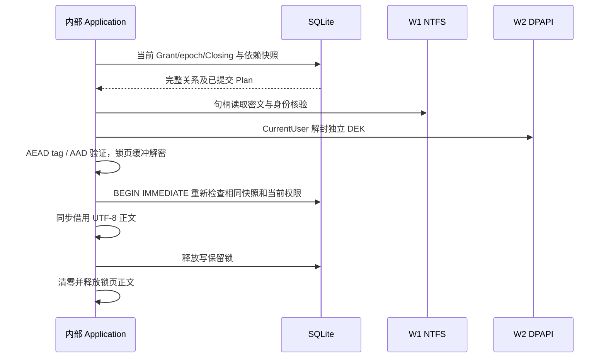
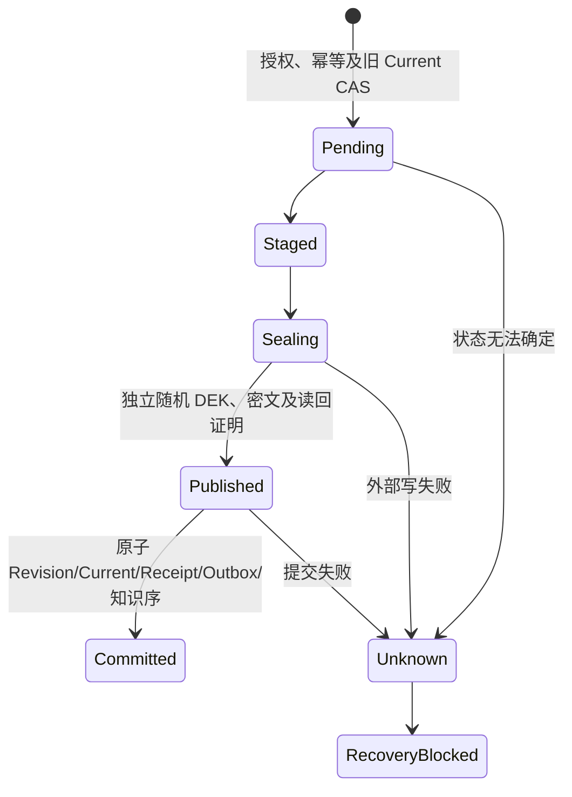

# R6-B2 读取与修订契约

2026-11-19，Windows x64 NTFS 内部实验。基线为 fcbca0d4e097042734744f982c1c69d49b729f8b。

Profile 10 DDL 采用 B1 原有定义。Revision 的 Parent 通过 Payload.operation 关联不可变 write_intent.expected_current。首次版本为 1，后续 number 递增，Current 指针通过旧 Revision ID CAS 更新。独立 Payload 和随机 DEK 每次重新生成。Receipt、Outbox、安全版本和知识序与 T1 一起提交。沿用 Profile 10 的历史 Outbox action MemoryCreated 表示 Memory 投影需要刷新，消费者需要检查对应 Revision.number。M1/M2 的独立历史数据库与签名查询接口沿用原实现。

正文在现有 LockedBuffer 中持有，VirtualLock 失败拒绝解密。类型无 Clone、Debug 或 Serialize，Drop 使用 zeroize，再解锁并释放内存。公开接口继续为 NoContentRuntime。受信内部调用方只获得限定生命周期的 &str 借用，无法返回借用引用。受信调用方有能力复制内容或长期执行，属于当前进程信任域。借用回调必须短时、无外部 I/O。此阶段验证同用户隔离测试宿主，正式隔离和受控 OS 输出仍待验收。

最终交付的线性化点为成功取得写保留锁后完成最后一次授权和状态核验。Closing 或撤权先提交时，回调不执行。借用先开始时，其他连接在借用结束前不能提交安全变更。取消、超时和进程锁均不赋予撤权完成语义。解密在锁外执行，最终状态变化会拒绝交付并清零缓冲。RAII 事务在 panic 时回滚，LockedBuffer 同时按栈展开清零。整个进程被强制终止时内存回收依赖 OS。

| 竞争 | 实测方式与期望 |
|---|---|
| 密文读回后、解封前、解密后 | 使用真实 SQLite 第二连接和双向 Barrier 提交 Closing、Source 失效、Generation、epoch、撤权。主线程必须拒绝正文借用。 |
| 同步正文借用期间 | 第二线程尝试写 Closing，SQLite Busy 拒绝。借用后重试撤权并确认后续读取被拒绝。 |
| 两个修订请求 | 两个线程同时发送给单 owner Application，使用相同 parent，恰好一个提交。 |
| 历史损坏 | 对独立测试对象篡改 AAD/tag/DPAPI 包装。目标历史拒绝，另一 Memory 仍可读。 |
| Current 指针损坏 | 拒绝全部该 Memory 的读取，不回退历史。 |
| Owner 重启 | 三个真实子进程，两个恢复交接。按 Child HANDLE 等待、停机账本摘要和一次性恢复回执核验。 |

恢复试验中的父 supervisor 保有实际 Child 对象，wait_clean 成功后才把已有私有退出证明传给下一受控子进程。测试元数据通过子进程环境传递，不包含正文或密钥。它属于受信测试宿主协议，无法对抗同账户篡改环境或运行代码。启动确认继续绑定该 Child 的 stdout、父进程发出的 nonce、安装、Realm 和新 incarnation。每轮 stdout/stderr 单独留存。真实服务身份和跨信任域退出证明本轮没有实现。

正文哨兵动态生成，日志只报告阶段和布尔匹配。扫描 UTF-8 / UTF-16LE，包括测试根中的 SQLite、WAL/SHM、TEMP、密文、包装、文件名、子进程日志。原有 B1 崩溃点扫描继续执行。OS 全局崩溃转储和休眠文件无法由该局部扫描证明不存在正文。

范围限制仍包括外部输出、生产身份、强删除、完整本地快照抗回滚、物理断电、其他平台。B2 的受控多轮重启只适用于匹配监督证明和干净停机的实验路径。指定 Luna High 的签核要按可核验的模型身份单独记录。
