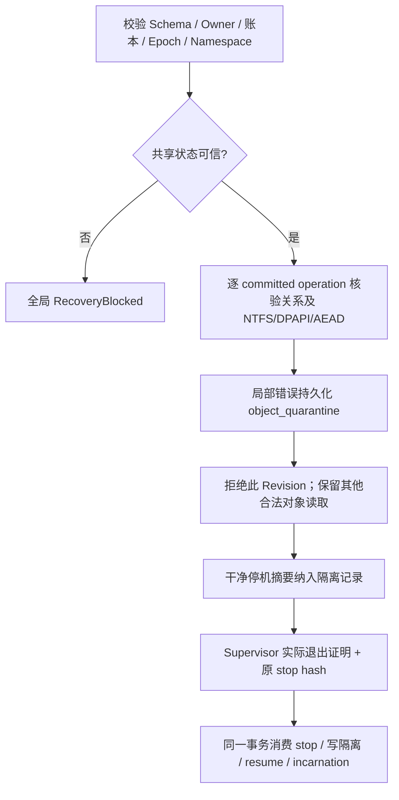
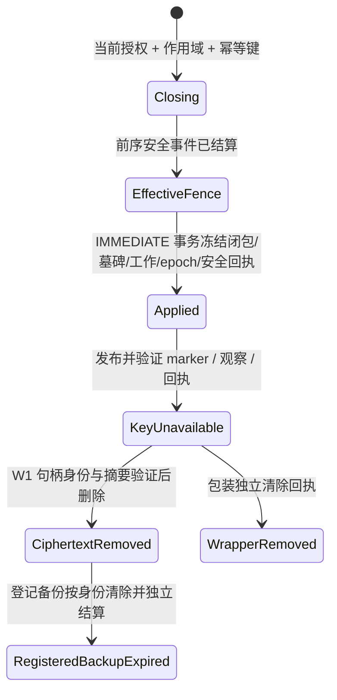

# R6-B3 Object Recovery / Deletion Closure

2026-11-19；仅 Windows x64 NTFS 内部合成实验。固定前置为 B2 `31549a5b6393c31f2d5bac40b3a9f27619eddb24`。决策见 ADR-M3-015。此文与源码一起审查，不是生产使用说明。

## 装配与兼容

`auth` 仅 Rust test harness 编译；Profile 11 位于其 Windows 私有模块内。没有 Cargo feature 或正常 Application 工厂可以装配。NoContentRuntime 内容仍 CapabilityUnavailable。没有生产身份、外部输出、服务安装或 Protected Witness。

Profile 11 只允许在空的独立目录受控创建。先执行原 Profile 10 DDL，再执行 0011 扩展及程序生成的不可变 ledger triggers。打开现存库只校验，不自动迁移。Profile 9/10 DDL、Cargo.lock 和原 Schema hash 均保留。P11 hash 覆盖两份受信 DDL；运行时完整 sqlite_schema 对比覆盖额外生成 trigger。P10 FK 错误全部拒绝；P11 仅指定局部关联错误进入隔离诊断。没有生产迁移器或旧库转换器。

## 对象隔离与共享故障

局部隔离不修改原 Revision、Current、Payload、Key、Receipt、Outbox 或 manifest。隔离 operation 通过不可变 write_intent 绑定完整对象与作用域。补回文件不会解除隔离；不能旧 Generation 回退。历史读同样检查隔离及当前授权。坏 Current 的历史正文不自动回退。

未知账本、Schema、权限/epoch、未完成写入、未知 marker/namespace、旧 stop hash、没有 supervisor 退出证明继续全局拒绝。强杀后的 Owner 没有自动恢复或强行解除接口。测试环境变量仅传递父测试 supervisor 验证的交接资料，不是生产 ExitProof。

## 删除闭包与线性化

图中 Applied 是逻辑失效，不是物理擦除完成。逐对象/动作/备份状态保存在独立表，不能将其中一项代替整个完成状态。

关闭入口与内容写读共用 SQLite 安全事件排序。多个 Closing 按 event 顺序推进，未完成事件继续阻止新内容操作。读取最终 IMMEDIATE 借用区间先取得排序权时，安全提交等待借用结束；Closing 先提交时正文回调不执行。受信回调必须短且不做外部 I/O；恶意或无限阻塞回调不在生产承诺内。

Memory 闭包为该 Memory 的全部 committed 历史 Revision、Payload、独立 Key、copy manifest 和备份登记。Source 闭包为同 Space 显式 Evidence 下全部依赖历史 Revision 的相同对象集。Memory-only 保留共享独立 Evidence/Source；Source 墓碑永久阻止依赖再读/以旧来源修订。没有跨 Space 或语义副本发现功能。

删除前检查所有受影响 Memory 的当前 Grant，在 Applied 事务重新检查。当前 Profile 的 Grant 是实验授权投影，没有新增生产删除 capability。权限不足在提交 Closing 前拒绝。闭包在同一 IMMEDIATE 事务读取，不从预检结果直接执行。读取资格以 r5_tombstone 和 generation 绑定为准；原 local_key 等历史元数据不因清理而从账本删除。

业务 knowledge_seq、Revision、Current、原 Receipt/Outbox 均保留；删除安全事件递增安全 epoch 并生成独立 security_receipt。测试核验业务历史未变。没有通过删除回执或 orphan 证据使账本“恢复正常”。

## Marker 与文件清理

marker 是带版本的不可变字节，绑定 installation 的 protection context、scope、owner、Revision、Payload、Key、generation、operation、删除意图。逐 operation 的第一条删除工作定义 marker；后续重叠请求复用该工作，不互相解除栅栏。文件名仍为 revoked-KeyId，使 W2 拒绝解封。

先提交 work，再在事务外 W1 no-replace 发布 marker，核验字节及 NTFS File ID，持久 observation/receipt。旧 W2 的其他 marker 格式不自动接受。marker 丢失、篡改或身份变化为共享阻断。

密文/包装删除由 W1 新的 erase_verified 约束实际句柄 Volume/FileId 和预期字节；先检查路径再无约束重开的方式没有引入。相同字节但不同 FileId 仍拒绝清理。永久 marker 保留；不覆盖旧密文或旧包装。

没有清除回执的缺失不冒充已执行删除；完成文件操作但回执未提交的未知结果保持待办/阻断。已有清除回执却文件再现为共享故障。文件/DPAPI 操作都不跨 SQLite 写事务。

## 备份及恢复上限

本轮实现的是单机受控登记备份：真实密文 Envelope + DPAPI 包装组合文件，不是明文。登记保留 generation、hash、FileId；本机每条备份有独立 receipt。备份清除只有匹配登记身份的文件被 W1 删除并结算后才能完成；意外缺失不发回执。

这些回执不覆盖未登记导出、离线备份、SSD 残留、物理介质安全擦除，也不证明完整历史 Windows/DPAPI/数据库/marker 快照无法回滚。Local 没有独立外部最新性权威。测试证明“只恢复旧数据库而当前目录/证明不同”拒绝，不能扩大为完整快照抗回滚。

## Outbox 与明文

P11 的 content_outbox_v2 提供 version=2，按 Revision.number 生成 MemoryCreated 或 RevisionCreated；不重写旧 outbox 行。未来消费者只能依赖版本化映射及 Receipt/Revision 关系，不能只按旧 action 字符串。P10 原消费者改造仍需显式兼容设计。

正文只在内部 LockedBuffer/受信借用中出现；数据库、WAL、TEMP、文件名、marker 和备份均不写正文。UTF-8 / UTF-16LE 动态哨兵扫描覆盖实际创建的测试产物；不把扫描视为内存取证或 dump 安全证明。

## 验证与交付

真实 SQLite / NTFS / CurrentUser DPAPI，子进程停机重启、定点强杀、双连接读/删除竞争、并发删除排队、SQL 事务回滚、局部关系损坏、marker 篡改、备份缺失和文件再现均有测试。故障日志保留成功和失败批次，不删除失败证据。

原始日志、源码快照及完整矩阵分离保存到本地 outputs/YixuMemory-R6-B3-20261119。执行范围及精确计数以该目录 REPORT.md / TEST_RESULTS.json 为准。完整 unfiltered Native 输出、服务身份、A3、R12、断电/真实磁盘故障、外部备份和跨平台均未验收。R6 整体及生产内容保持 NOT READY。指定 Luna High 最终签核 NOT TESTED。
