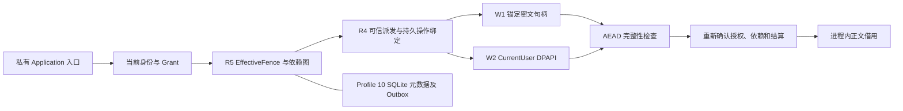

# R6 Local Content Engine 进度与设计

本文件保留首次 AEAD 原语提取的阶段记录。R6-B1 已继续实现 Profile 10 正文创建及重启对账，当前结果以 [B1 实施报告](M3_R6_B1_PROFILE10_WRITE.md) 为准。下文的未实现和 NOT TESTED 表格描述首次阶段，B2/B3 完整生命周期仍未验收。

**整体状态 NOT READY**

私有 R5 基线为 `6e4139d63362b8a69011b277250848270a45037e`，父提交为 `0b489e0de53cbf2ef3786e88b58d318778e7cd92`。开始时工作区干净。R6 分支为 `local/p1-m3-w4a-r6-local-content-engine`。私有快照的 README 指向公开基线 `85f033e646b5446d02a0fdc9a3bf92a0ee8dd0e0`。在该基线核对了 `AGENTS.md` 和 `docs/SYNC_POLICY.md`。两个已跟踪的 Rust 锁文件以及 Profile 9 的 DDL 未更改。

本次代码仅在 SQLite crate 的 Windows 测试图中提取了现有 XChaCha20-Poly1305 封装，使用 OS 随机 nonce 和自动清零的锁页缓冲区。旧调用方继续使用原格式和固定长度检查。新增测试覆盖可变长度 UTF-8、重复封装 nonce、内容与 tag 篡改、错误密钥材料、错误 Key ID、Tenant、Space、Revision、Payload 和 Generation。该单元测试没有通过 Application 执行正文操作。

## 目标架构

当前 R4/R5 的合成装配和 W1/W2 的 DPAPI、NTFS 实现位于不同 crate 的私有测试模块。R4/R5 已有文件重开是只读对账，原生 Profile 9 的恢复保持阻断。Profile 10 的代码还需组合这些边界，并建立 R6 进程内装配自己的可验证重开路径。两套独立事务分别提交授权账本和可读 Revision 会留下竞态窗口。设计要求在同一个 Profile 10 写事务中完成可见性、授权版本、R5 墓碑／回执及 Outbox 变更。

## Profile 10 草案

| 记录 | 主键与约束 |
|---|---|
| 安装与运行实例 | 绑定独立 application ID、user version、schema 摘要、安装 ID、realm、启动 incarnation 和安全 epoch。全新数据库独占创建。已有文件只按匹配的格式和证据开放。 |
| 写入意图 | 同一 scope 与 principal 下 Request ID 唯一。固定目标、当前 Revision CAS、Source、Evidence、待发布文件 ID、Key ID 和 Generation。仅已确认尚未开始的工作可在新的授权下处理。 |
| Memory、Revision、Payload | 复合外键固定 Tenant／Space。Revision 不可变并单调递增，当前指针和完整业务图在同一事务更新。Payload 保存文件和 Key 引用、Generation 与经过校验的密文摘要。 |
| Key | Key ID 与 Payload 一对一。保留精确绑定、当前 Generation、包装版号、包装摘要及不可撤销的本地撤销记录。 |
| Security Event、Receipt、Outbox | 复用事件顺序、EffectiveFence 及不可变回执。逻辑删除、密钥不可用、密文文件移除、副本清除和备份过期各自有可证实状态。 |

新格式的认证数据应规范化绑定格式版本、Tenant、Space、Memory、Revision、Payload、Key ID、Generation 和本地安装身份。正文在进程内借用，密钥和解密输出使用受限缓冲区，调用方的输入拷贝和 OS 转储不属于绝对擦除保证。DPAPI 包装丢失只足以支持当前安装的不可用判断。未知副本和快照不得推定清除。正常重启应在新授权下查验停机与持久结算证据，旧完整回滚域不可由 CurrentUser DPAPI 独立识别。

## 崩溃与泄漏验收矩阵

下表是 R6 的预期结果。旧 W1/W2/W3 测试通过不能替代 R6 断言。

| 边界 | 应观察到的结果 | R6 状态 |
|---|---|---|
| 正文写入、Key 发布、密文发布中断 | 保留原意图和现有文件。半成品不可读，证据不足留在 RecoveryBlocked。 | NOT TESTED |
| SQLite 提交前、后 | 提交前业务图不存在。提交后精确回执和图原子存在，响应丢失可查回执。 | NOT TESTED |
| 有证据的停机和真实进程重启 | 旧 owner 退出。新 owner 对账并验证当前授权、文件绑定、DPAPI、AEAD 和 R5 状态。 | NOT TESTED |
| 撤权与解密竞态 | 返回前重读安全边界。撤权先进入 Closing 时拒绝交付。 | NOT TESTED |
| 密文缺失或损坏、Key 不可用、旧 Generation | 拒绝对应读取。报告对应对象状态，不重新封装替代密钥。 | NOT TESTED |
| 删除过程中断 | 已确认的步骤有独立回执，未确认步骤保留待办或阻断。 | NOT TESTED |
| 新版本正文哨兵 | 覆盖 SQLite 主库、WAL、SHM、TEMP、日志及文件产物。断言输出不包含哨兵。 | NOT TESTED |

## 修改范围

- `crates/sqlite/src/auth/persistence.rs` 转发原有封装与打开逻辑。
- `crates/sqlite/src/auth/persistence/content_crypto.rs` 持有共享 AEAD 实现和两个 Windows 单元测试。
- `scripts/check_surface.py` 增加外部 all-features 编译拒绝探针。
- 本报告与 [调研清单](M3_R6_OPEN_SOURCE_REFERENCES.md)。

## 实测状态

| 结果 | 范围 |
|---|---|
| PASS | Rust 默认 368 项和 all-features 370 项。两组各包含 10 个仅用于子进程启动的辅助入口，业务与其他回归测试分别为 358 和 360 项。另有 10 个独立 doctest。 |
| PASS | Rust fmt、Clippy `-D warnings`、48 个外部编译拒绝探针、4 个依赖图检查。 |
| PASS | C 盘 NTFS 上的公开基线副本通过 Python 611 项。私有 Schema 和契约测试 49 项。私有测试初次访问既有系统 TEMP 目录被拒，使用本次验证专用的 NTFS 临时目录重跑通过。 |
| PASS | 私有源码清单及静态凭据扫描通过，公开基线跟踪文件扫描 110 个路径、0 个匹配。 |
| CONDITIONAL | 独立代理核对了 R5 恢复边界，并审查了本次原语变更。它确认旧格式、边界检查及私有编译图保持有效，指出未来业务入口需要独立验证 UTF-8 与完整新格式绑定。指定 Luna High 的模型身份未能核验。 |
| NOT TESTED | R6 专用进程恢复、真实正文泄漏扫描以及删除／修订／历史读取矩阵。 |
| NOT READY | 首次阶段的 Profile 10 和 Application → R4／R5 正文运行链尚未实现。独立代理的原语复审结论仅覆盖当时的改动范围，完整 R6 复审待实现。后续结果见 B1 报告。 |

命令及完整输出保存在仓库下的 `verification/r6-preflight`。该目录按基线规则属于本地验证产物。
