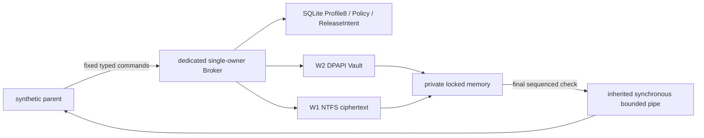
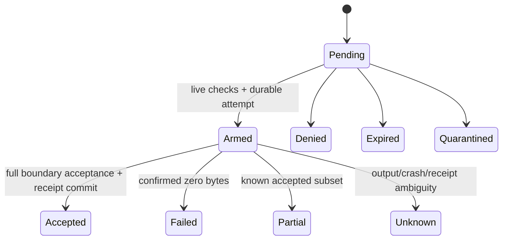

# W3 release protocol and verification matrix

See ADR-M3-006 for trust assumptions and implementation limits.

All terminal states prohibit outgoing transitions. Reopen is a NEW authorized request, never
reuse of an accepted/unknown release. Same request/digest replays ID/status only. Different
digest conflicts. Principal/scope/destination checks precede selection; epochs are not bearer
permissions. Internal DTOs have no public serialization/constructor path. Existing deletion
intent retains its original closure and receipt meaning.

| Fault | Expected rule | Evidence scope |
|---|---|---|
| Revoke before unwrap | Denied; no sink event | W3 real SQLite |
| Revoke during unwrap | post-unwrap Policy rejects | W3 second connection plus W2 race regressions |
| Revoke after unwrap before output | final check then actor sequencing | W3 command-order history; W2 checks; no arbitrary DB writer guarantee |
| Output crash | Armed -> Unknown, no replay | W3 actual child kill after flush |
| DB commit / external pending | Armed is not success | W3 injection and actual child kill before write |
| Old worker/broker | stale incarnation/attempt denied; live lock excludes second | W3 restart + cross-process lock |
| Intent replay | status only; changed input conflict | W3 runtime + unique constraint |
| Wrong generation | exact binding refused | W3 and W2 DPAPI/AAD tests |
| Marker missing | DB tombstone still denies | W3 actual marker removal inside owned test directory |
| Cipher replacement | hash/AAD/AEAD fail | W1/W2 suite; W3 missing-file case |
| DPAPI unavailable | no derived fallback | W2 failure paths; W3 missing wrapper/unknown gate; no actual SID/profile switch |
| Multiple reads | distinct requests permitted; same request once | W3 repeated reads and command queue; not saturation testing |
| Delete/release | append-only overlapping fences deny | W3 fences; no physical deletion service |
| Old DB backup | current marker denies; whole-domain rollback not promised | W2 backup experiment; no W3 backup restore API |
| DB/Vault/profile mismatch | unavailable, no regeneration/import | W2 plus W3 missing objects/gates |

Production NoContentRuntime stays CapabilityUnavailable. Protected mode has no backend/issuer
and cannot downgrade. Windows NTFS only; Linux/macOS NOT TESTED, exFAT unaccepted. No new
capability claim arises from a profile number. Security test counts are not production proof.

Remaining gates: authenticated IPC/identity, private process/account ACLs, full security command
coverage in a future production service, real runtime assembly, bounded backpressure/cancel proof,
clock anomaly policy, physical power loss, independent recovery authority, deletion coordinator.
