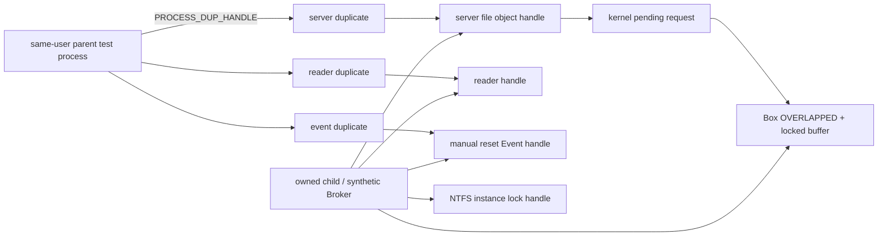

# W4-A2-R1: handle ownership and the recovery refusal boundary

Status: CONDITIONAL PASS for the experiment; A3 still NOT RUN. No recovery issuer implemented.
Frozen base a1049b4a04e9b0d4640c198226ba86b6e3ce8db6; W3 f836fbd74ae5417b9e50c41051f3b07e4c7d56b1.

## Finding and scope

Actual owned Windows child experiments demonstrate that noninheritable handles can still be
explicitly duplicated into another same-user process. OpenProcess QUERY_LIMITED_INFORMATION
alone followed by DuplicateHandle returns access denied 5. PROCESS_DUP_HANDLE succeeds here
for reader, server and event handles. No privilege was enabled, no account/DACL/system config
changed, no process outside this experiment opened or suspended. Success is measured in the
current inherited identity/integrity configuration; arbitrary SID/PPL/token combinations and
non-parent third processes have not all been tested.

The original reader closing does not terminate the write while another process holds a reader
copy. The child polls the actual pending OVERLAPPED and returns no terminal evidence. With the
child alive and its instance lock retained, a new managed startup refuses. The parent can still
create another raw synthetic Session because BUSY is process-local; that is a counterexample
to treating BUSY as system-wide enforcement, not a second authorized content release. NoContent
has no issuer and this raw API is test-only. Production enforcement remains unaccepted.

Suspension uses a thread snapshot filtered to ONLY our still-owned child's PID, revalidates
GetProcessIdOfThread on the opened thread handle before SuspendThread, records actual
SuspendThread previous counts, and RAII ResumeThread undoes exactly our increments. Replacement
still refuses the lock while those threads are suspended. This is a finite observed thread set,
not proof that a malicious process can never create an unseen thread; suspension also does not
freeze kernel I/O. It is not a takeover or synchronization mechanism.

After child termination: with only a foreign reader/event copy, PeekNamedPipe returned 109;
with a foreign server handle too, the pipe remained queryable (success, zero available bytes in
the measured run). The copied event was signaled in both cases. Neither object liveness,
broken-pipe state, event signal, PID exit nor lock availability yields the missing original
operation's byte count/completion identity. No attempt is made to dereference an OVERLAPPED
address in a dead process or recreate a completion from its event handle.

Important distinction: Microsoft documents that TerminateProcess initiates cancellation and
the process cannot finish exiting until its pending I/O has completed or been cancelled.
Waiting on the actual owned process handle (rather than merely seeing PID disappear) is
therefore relevant evidence of that process's I/O quiescence under the documented OS contract.
It still does NOT reveal per-operation counts or normal-vs-cancel outcome, settle the DB,
remove foreign copies/previously accepted bytes, or stop other processes issuing new I/O through
their copies. A surviving pipe object is not proof that the dead process's old request is still
running. The measured foreign Event was signaled; we do not use it as a cross-process receipt.

## Ownership graph

The arrows from duplicates denote shared kernel objects, not identical numeric handles or a
transfer of the child-owned OVERLAPPED/buffer into the parent address space. The parent closes
all copies it created; that does not prove absence of unknown copies in an actual deployment.
Client-controlled readers can retain already accepted bytes. A private server/event duplicate
outside the trusted output owner invalidates exclusive ownership assumptions. Inherit=false
only constrains automatic inheritance, not explicit duplication.

## TerminalEvidence handoff design (NOT IMPLEMENTED)

Native owner harvests matching GetOverlappedResult into non-Clone evidence binding OperationId,
ConnectionId, Attempt, BrokerIncarnation and trusted payload scope. Normal completion uses exact
counts only when guaranteed; cancellation/error use conservative ranges when counts are unknown.
Timeout, close and cancellation requests remain Unsettled and do not enter this path.

A future private settlement component consumes that evidence while retaining the logical output
and connection budget. In one BEGIN IMMEDIATE transaction it checks the stored binding and
incarnation/attempt, appends immutable terminal_evidence, advances output_operation, and records
the exact outcome/receipt. No native/file/key I/O occurs in that DB transaction. Only its durable
receipt permits the sequencer to consider the operation settled. Outcome Unknown+NoPending is
distinct from Unknown+Unsettled. Failed commit means no Accepted response, no automatic replay,
and budget stays blocked even if the native buffer can safely be wiped after true completion.

Completion observed but DB not committed, or crash after that observation, loses a process-local
proof. The new experiment kills such a child after real 4096-byte normal completion and before
any DB handoff; Profile9 has zero receipt and stays RecoveryBlocked. It does not claim to be a
fully integrated Armed/T1 release. Existing Profile9 transactional receipt rollback tests cover
the DB half independently. No synthetic observation is promoted to an authenticated OS receipt.

DB commit success/reply lost: after current-authority reconciliation, query the exact immutable
operation receipt and return status only. Conflicting bindings reject. Old contexts/epochs and
new requests still need live authorization. No receipt authorizes replay of body bytes. If the
DB is a known old backup, current authority cannot be established, or an old sender remains
possible, refuse rather than adopt a historical Ready row or signature.

## Ready authority and minimum prerequisites

There is no Ready issuer in this prototype. Profile9's existing open path always mints a new
incarnation and RecoveryBlocked. No code or fixture added here clears it. A potential future
Ready signer must be a trusted recovery authority, not a client, lock owner or timeout callback.
Required evidence includes: verified old instance identity/incarnation; exclusive actual output
ownership; no unaccounted server/event/lock handle copies; old I/O terminal or enforced old-output
isolation; durable receipt/security-intent reconciliation; current grants/source/key/generation
state; controlled connection closure and cross-process quota; no unresolved old backup import.
Every missing premise keeps the realm blocked. R12 success is NOT RUN.

Keep these future types separate: NativeTerminalEvidence (live owner harvested the exact
operation), ProcessExitObservation (stable process identity and signaled handle),
EnforcedOwnershipEvidence (trusted identity/ACL/lifecycle policy, not self-reported absence of
copies), and PersistedSettlementReceipt (exact immutable DB operation/result). A recovery
authority must not convert the latter three into fabricated NativeTerminalEvidence. A future
separate RecoveryAdmissionProof could use independently verified output isolation plus current
durable security reconciliation, but no such issuer or success path exists here. Signature or
boolean fields alone cannot create the missing OS ownership premise.

Same-user current DPAPI/process/pipe setup cannot establish these stronger isolation premises.
A production candidate would need an explicitly provisioned dedicated service identity or
service SID/restricted-token design, process and object ACLs preventing untrusted DUP_HANDLE,
VM/remote-thread/permission-control access, minimal inherited handle lists and trusted lifecycle
management. This is only a deployment requirement proposal; no account/service/global ACL is
created here, and an administrator/kernel remains outside the assurance. It must preserve Local
offline use. W2 already excludes hostile full same-OS-identity control; these findings confirm
that limit rather than silently expanding it.

A dedicated identity would also change the DPAPI user context: existing W2 user-scoped wrappers
cannot be assumed portable to it. Any future rewrap/migration needs an explicit ADR, current
nonrevoked authorization and separate validation; never select machine scope or resurrect keys
as an automatic compatibility fallback. No such identity or migration is adopted here.

Even stronger identity separation alone does not manufacture a crashed owner's completion
receipt. Keep crash takeover unsupported until actual isolation/settlement proof exists. If
future availability requirements demand recovery without that proof, consider a trusted output
host retaining the native operation across domain-Broker failure or fencing at the actual sink;
either is a separate architecture decision requiring review, not implemented in this task.

## Stage stop and verification

Stage2 found insufficient isolation, so stages3/4 add no runtime coordinator, Profile9 migration,
manual reset, Ready path, Witness, KeyVault output or recovery bypass. Changes are test-only
experiments and this design record; the existing tests' expectations are unchanged. The shared
test mutex visibility is widened only inside the private native module to avoid parallel test
interference. Raw experimental I/O must never be confused with an authorized Application path.

R01-R07/R10-R11 include native/owned-process evidence or refusal; R08 and R09 retain existing
SQLite/pure-contract regressions independently; R12 success is NOT RUN. Overall CONDITIONAL PASS:
the measured failure model is useful and no current synthetic invariant is bypassed, but A3
prerequisites remain unmet. A signal on a copied Event is not a completion receipt.

Primary references: Microsoft DuplicateHandle, Process Security and Access Rights, SuspendThread,
GetOverlappedResult and CancelIoEx; measured results are separate from documentation. No external
implementation copied, no dependency added, no process memory read, no privilege adjustment.
