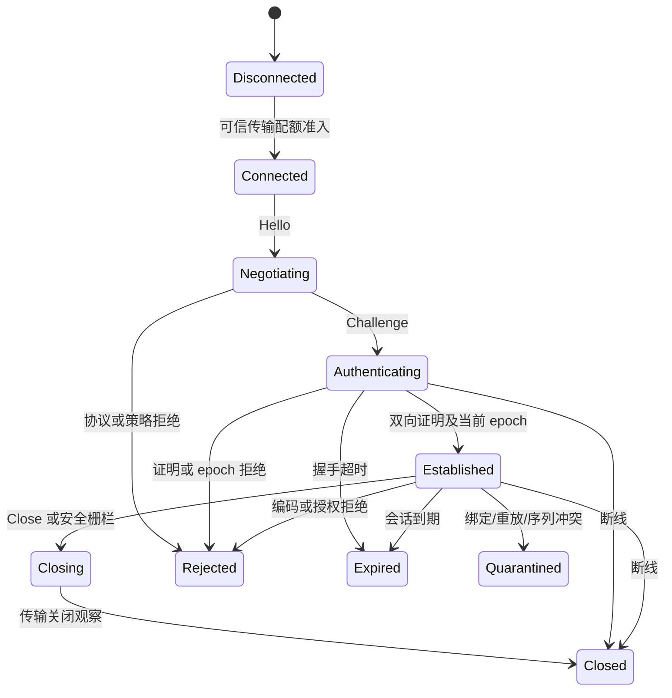

# W4-A2-R3 线协议与调度契约

本文件定义合成控制面的 v1。规范和装配边界见 [ADR-M3-011](M3_ADR_011_IPC_PROTOCOL_CORE.md)。

## 线协议

多字节整数均为无符号大端。ID 为原始 16 字节。无对齐填充、字符串、变长整数或可选编码。

| 偏移 | 字节 | 字段 |
|---:|---:|---|
| 0 | 4 | 魔数 ASCII YXIP |
| 4 | 2 | 帧版本 1 |
| 6 | 1 | 消息类型 1 至 7 |
| 7 | 1 | Flags 保留为 0，任何其他值拒绝 |
| 8 | 16 | Session ID |
| 24 | 16 | Request ID |
| 40 | 8 | 方向内 Sequence Number |
| 48 | 4 | Payload Length，最大 512 |
| 52 | 0 至 512 | Payload |

最大总帧 564 字节。长度先用 u32 比较上限，再转换、相加。Datagram 解码须严格相等。Stream decoder 持有一个固定缓冲，每次接受至多 564 字节的块并返回实际消耗。调用方保留未消耗后缀，背压时暂停读取，EOF 拒绝残帧。错误使 decoder 失效。v1 只支持底层有界分块重组一帧，单请求没有应用层连续正文或跨帧拼接。

| 值 | 方向与序号 | 规范载荷与限制 |
|---:|---|---|
| 1 Hello | C→S 0 | 两个 ID 为零。u16 精确版本 1，Realm/Tenant/Space，Principal，u64 epoch，32 字节 client nonce。总长 106。 |
| 2 Challenge | S→C 0 | 服务生成非零 session，request 为零。16 字节 incarnation、32 字节 server nonce、32 字节 server proof。 |
| 3 Authenticate | C→S 1 | 匹配 session，request 为零，32 字节 client proof。 |
| 4 Ready | S→C 1 | 匹配 session，request 为零，载荷为空。含义仅为协议 Established。与 W4 RecoveryAdmissionProof/Ready 不共享权限。 |
| 5 Request | C→S 从 2 递增 | 匹配 session，非零 request。48 字节 scope，opcode 0 Probe 或 1 Inspect。Probe 无参数，Inspect 恰好一个非零 16 字节标识。 |
| 6 Cancel | C→S 递增 | 匹配 session，request 为目标 ID，载荷为空。 |
| 7 Close | C→S 递增 | 匹配 session，request 为零，载荷为空。 |

所有未定义类型、保留位、固定记录长度偏差和非法零值均拒绝。R3 只有握手回复帧。队列状态和错误通过类型化核心返回值观察，未来传输适配器定版其回包。任何 PID、进程名或管道名都不进入身份判定。

客户端只提供精确版本 1，服务只选 1，拒绝其他版本或尝试以旧版重试。Transcript 为字面量 `YXIP/handshake/v1` 加 NUL，接 offered/selected u16、48 字节 scope、Principal、epoch、client nonce、server nonce、session、incarnation、32 字节可信传输绑定。字段定长，方向角色由证明域分离。双方在同一 transcript 上验证，客户端使用可信来源的预期 incarnation 与实际传输绑定，验证 Challenge 后才提供 client proof。服务校验证明和当前 epoch 后建立会话。传输适配器须验证真实对端、独立信任根、每连接新鲜绑定及所有后续帧的通道完整性。帧编码和测试 HMAC 不提供该传输能力。

服务生成 session，使用带域分离的 SHA-256 对 incarnation、连接绑定与受检单调序号编码，截断到 16 字节。检测活动 ID 碰撞并拒绝。该值用于关联。权威仍来自握手绑定与私有装配。新进程必须由受信装配分配新 incarnation，绝不恢复旧 session。Hello 可触发新 Challenge，旧 Challenge proof 不能在另一连接、session 或 incarnation 完成认证。

## 会话与调度

握手有效期 30 秒，会话 300 秒，宿主提供进程单调秒计数。时钟倒退拒绝，溢出拒绝。会话不会延长授权。域与 epoch 在认证、入队、派发前检查。安全事件由宿主串行调用且优先于后续数据请求。删除栅栏按 scope 持续阻断。当前 realm 的栅栏含非法 Tenant 或 Space 时返回编码错误并阻断整个 realm，避免确认一个永远不匹配的栅栏。累计超过 16 个作用域也阻断整个 realm，v1 无清除入口。预认证阶段无需查询客户端业务权限，握手成功前不生成可调度工作。

每个 Core 固定一个 realm。最多 8 条占用连接，每连接最多 4 个未完成请求，全局排队最多 16 个，另有至多 1 个已派发槽。按连接 round-robin，每连接 FIFO。仅观察到传输关闭且无已派发保留时才能退账。错误、超时和 CancelRequested 都不能用于绕过连接或派发预算。调度器以独占可变引用串行运行。真正跨进程预算由未来唯一可信服务保证。

入站序号精确单调，不回绕。背压未接纳该帧，调用方暂停并以同序号重试。已接纳的重复字节帧按旧序号拒绝。若使用新序号查询同一 request ID 和摘要，只返回当前状态。摘要为 `YXIP/request/v1` 加 NUL、Principal、epoch、规范载荷的 SHA-256，载荷已包含 scope 和 opcode。序号和 Request ID 各自单独校验。每 session 最多保留 32 个不同 ID，从不驱逐旧记录为重放让位。同 ID 不同请求隔离会话。跨 session 的持久业务幂等键仍由现有业务层负责。

排队请求可在未提交前丢弃。已派发的取消只进入 CancelRequested，断开或到期进入 Unknown，保留在途槽和连接配额。会话状态不能生成 NativeTerminalEvidence。R3 没有生产派发或结算回调。测试私有元数据结算只用于验证轮转，不能结算原生操作。任何未知结果都不自动重发。后续只有受信 Native 终态及匹配的持久结算才能按 ADR-M3-009 释放真实输出预算。

## 测试矩阵与证据层级

| 类别 | 测试路径与断言 |
|---|---|
| 帧 | 最大合法帧、已知大端字节、1/7/52/564 字节分块、同块两帧、EOF、所有截断前缀、尾随字节、非法 magic、未知 kind/flags、错误版本、513 和 u32::MAX。 |
| 身份 | 双向合成证明、假 server proof、server proof 反射为 client proof、旧 proof 改 ID、ID 冲突保留 owner、错 realm/Tenant/Space/Principal/epoch、错 channel、过期、认证中断线。 |
| 授权和顺序 | 认证后撤权、事件未到但实时 epoch 已变、跨 scope 请求、旧 incarnation、旧序号/乱序/超前、同 ID 去重、同 ID 不同摘要、ID 历史耗尽。 |
| 队列与取消 | 八连接并发、单连接洪泛、全局队列满、背压重试、FIFO/round-robin、Closing 拒绝新请求、取消与删除/撤权的两个顺序、畸形本域栅栏阻断排队任务、断线或超时保持未知槽。 |
| 恢复 | 自有测试子进程在握手中、提交前、写入但未 commit、commit 后无回执时被终止。新 incarnation 拒绝旧连接/证明。哨兵 knowledge_seq/业务写/Outbox 保持 0/0/0 或原来已提交的 1/1/1。哨兵是隔离的 SQLite 测试接收端。 |
| 隔离 | 默认 CapabilityUnavailable、外部编译拒绝私有会话和装配、拒绝把 Scheduled 转成业务 AuthContext、无原生终态入口、all-features 正常依赖图排除 test-support、业务层与 Windows adapter。 |

Windows 是本轮 Rust 与进程故障试验的执行主机。Windows 原生身份、服务安装、DPAPI、真实输出、生产恢复、Linux/macOS 兼容性均需分别验收。
