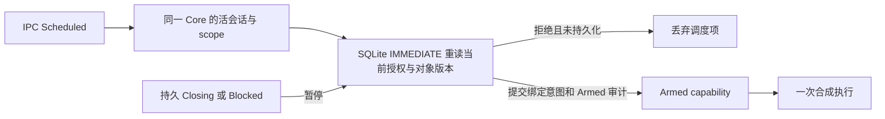
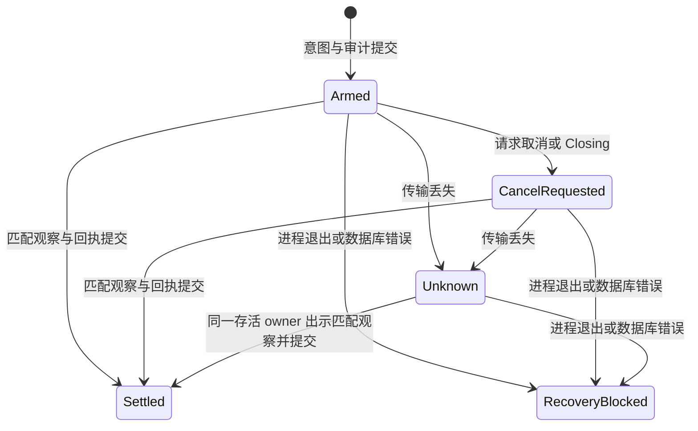

# W4-A2-R4 可信派发与合成结算

设计及兼容性见 [ADR-M3-012](M3_ADR_012_SYNTHETIC_DISPATCH.md)。R4 代码位于 R3 私有测试模块。公开的 Core 默认返回 CapabilityUnavailable。实验库只接受新建路径，正常编译图没有连接实验 SQLite 的入口。

派发再次检查 R3 epoch 和期限。SQLite 检查主体、Grant、业务期限及可读快照。绑定摘要使用固定字段顺序、大端整数、SHA-256 和域标签。字段含作用域、主体、目标、请求 ID、R3 摘要、会话、通道、会话期限、incarnation、连接序号、操作号、attempt、业务 epoch、Grant 期限、Revision、source/key/copy/deletion generation。操作号由写事务分配。同主体和 scope 的 request ID 在数据库内唯一，重连不能重用已派发 ID。合成模型每个数据库只有一个 scope/主体/目标授权行。

观察先独立提交，仍占用逻辑在途槽。结算只接受匹配的 operation、attempt、绑定摘要及合成结果。插入不可变 receipt 的事务同时写 Settled 审计、转换意图并借部分唯一索引退还持久槽。随后同步内存派发和连接计数。提交失败使 owner 持续阻断，重开只允许 RecoveryBlocked 只读对账。已提交回执按精确绑定查找。重开时保留原意图和观察历史，合成观察不能换取新运行权或重新派发许可。

| 竞争与事件 | 顺序与结果 |
|---|---|
| Grant、Revocation、Delete、Revision、Source、Key、Copy、Principal、Space | 同一路径持久 Closing，停止本 realm 新准入，关闭旧会话，已派发项请求取消。 |
| Closing 先于派发 | 排队项丢弃。没有 ReleaseIntent 或业务写入。 |
| 派发先于 Closing | 在途持久槽仍占用。取消或 Unknown 保持 Closing。匹配的合成观察和持久结算均完成后才能推进。 |
| 多个 Closing | 按事件 ID 先后推进。释放在途与已断开连接计数后允许 EffectiveFence，随后单事务更新合成授权/世代和 Applied。任何后续事件待处理则继续停止准入。 |
| 非法本域事件 | 记录持续 Blocked，关闭内存准入，再返回坏绑定。若数据库阻断记录失败，内存仍阻断，重开仍只读。 |
| 回复丢失 | 只核对持久回执。它不需要重开 Broker，也不重新执行动作。 |

| 故障入口 | 期望意图/观察/回执/审计计数 |
|---|---|
| Armed 事务提交前中止 | 0/0/0/0 |
| Armed 提交后中止 | 1/0/0/1 |
| 合成终态观察提交后中止 | 1/1/0/2 |
| 回执提交后响应前中止 | 1/1/1/3 |
| 结算审计触发器拒绝 | 1/1/0/2，结算事务全部回滚 |

Rust 测试走真实 R3 握手、调度与 R4 协调器，并另有自有子进程故障入口。Python 测试直接加载同一 SQL，单独验证数据库约束、回滚、只读重开和上述四个已知提交边界。哨兵 evidence 检查 knowledge_seq、业务写入和 Outbox。Python 覆盖止于 SQLite 模型，不能替代 Rust 协调器或真实业务库的验收。

实验以单 owner 与可信 SQLite 连接为边界。直接文件写、介入运行期 schema、跨进程部署所有权、物理 I/O 和受保护恢复域需要独立验证。R4 续接 Profile 9 的顺序不变量，使用独立合成表与类型。业务数据库与 Profile 9 扩展留待新 migration 提案。
