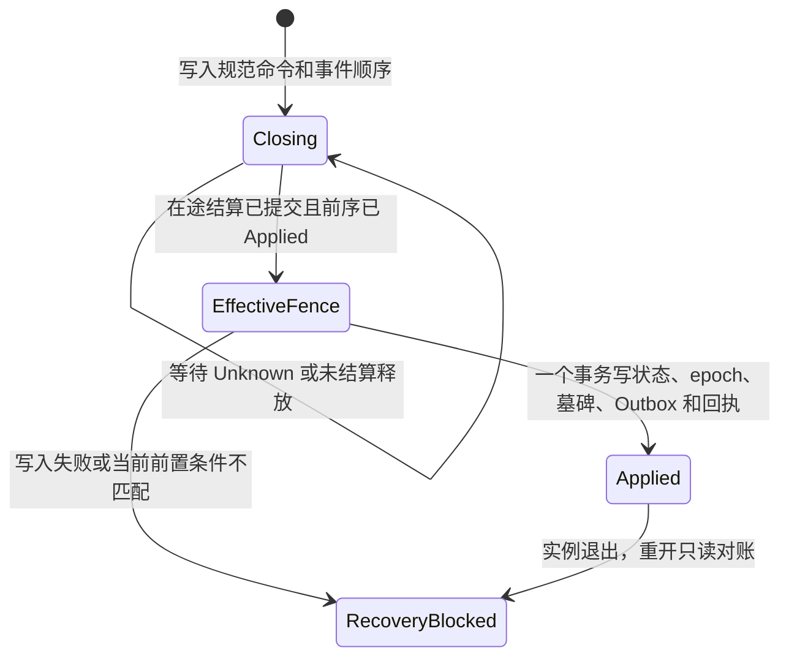
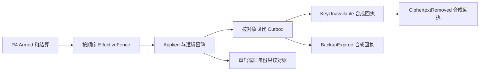

# R5 安全状态闭环

本实现运行于单 realm、单合成主体、单 Broker 的测试装配。同一数据库包含多个 Memory 以验证共享来源与历史闭包。R4 Inspect 的一个固定 Memory 使用该图的 Current Revision 投影。角色、作用域和合成认证仍由 R3/R4 校验。

| 命令 | 作用域及前置条件 | 生效 |
|---|---|---|
| Grant / Revoke | 固定 realm/tenant/space 与合成主体。Grant 校验期望 epoch 和主体、空间状态。 | 更新 Grant，递增 epoch，旧会话须重新认证。 |
| DisablePrincipal / DisableTenant / DisableSpace | 固定合成主体、Tenant 或 Space。Tenant 包含唯一被模拟的 Space。 | 单向关闭相应读取资格。 |
| Revise | CAS 匹配旧 Current Revision，同 Memory，世代前进。 | 校验下一个 Revision 的完整读取依赖，原子切换投影。历史行不覆写。 |
| InvalidateSource | 显式 Source ID 及世代。 | 来源、证据、所有引用 Revision 及各自拥有对象逻辑失效。 |
| RetireKey / RetireCopy | 精确 Key 或 Copy 世代。 | 拒绝依赖该对象的读取。Key 排队不可用确认。独立 Copy 退役只做逻辑失效，删除操作才安排密文清除。 |
| Delete | Memory、Source、Evidence 或 Payload 的明确同域对象及世代。 | 提交逻辑闭包与逐对象清单。已退休世代的重复工作复用原回执。 |

Closure 图在新库初始化时检查对象、父边、证据引用、Current Revision、Payload 对应 Key 和 Copy。运行时图不可增删。Copy 退役保守阻断该合成读取，即使存在其他副本。来源删除只覆盖明确的当前 Space 图。当前状态作用于历史 Revision 读取资格。逻辑失效的旧 Revision 不会因新 Revision 或 Grant 复活。Key / Copy / Backup 的证明全部是合成观察，真实密钥释放、轮换、销毁、物理清除和备份过期均需独立验收。

| 崩溃 / 异常边界 | 对账与准入 |
|---|---|
| 撤权 Closing 提交后 | 命令可查，无 Applied；不得重新开放旧会话。 |
| 删除 EffectiveFence 后或 Applied 事务中 | 栅栏保留，未提交变更、墓碑与 Outbox 整体回滚。SQLite 可能需要回滚热日志，之后只能只读检查。 |
| 删除 Applied 提交后 | 逻辑拒绝和待办工作同在。 |
| Key 合成观察提交后 | 观察在，回执仍未落地。报告待结算。 |
| Key 合成回执提交后、副本处理前 | 单独报告密钥回执；副本和备份仍待办。 |
| 释放 Unknown 或缺少命令/终态证据 | 在途操作不可重放，安全事件不能越过。对账拒绝不一致的记录。 |
| 旧数据库、旧 Revision 或旧世代 | 旧库可只读诊断。没有 Ready 签发或恢复为可访问的路径。 |
| 相同请求 ID / 错配请求 | 按作用域、请求 ID 和规范命令核对原事件。异命令 Conflict，未知 ID 无结果。重开后沿用同样的只读核对。 |

`Applied` 只表示逻辑结果已生效。待办为零表示已登记的合成工作均有回执。R5 没有对系统上未登记副本或全部快照作判断的依据。Profile 9 的实际账户、数据和恢复流程独立于此实验。
