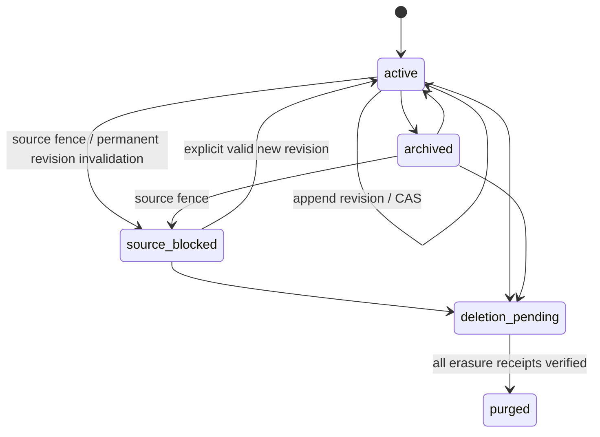

# 生命周期与状态转换

所有转换服务端授权、校验 expected version、产生 system_action 事件并与状态/outbox 原子提交。表外转换一律 409；未授权统一 404 或 403，不泄露存在性。

| 对象 | From → To | 条件/副作用 |
|---|---|---|
| Memory | 不存在 → active | 首版+证据+current 原子建立 |
| Memory | active → active | 追加 revision，CAS version+1 |
| Memory | active → archived | 保留证据，默认检索排除 |
| Memory | archived → active | 显式恢复，所有来源仍可访问 |
| Memory | active/archived/source_blocked → deletion_pending | 锁定读写、形成删除闭包、递增 generation |
| Memory | deletion_pending → purged | 全部回执含备份处理门槛通过，仅保留无内容 tombstone |
| Memory | active/archived → source_blocked | 来源擦除的完整闭包授权后原子栅栏；旧 Revision 追加不可逆失效记录 |
| Memory | source_blocked → active | 所有相关来源擦除 completed，显式 CAS n+1、新有效证据/独立内容/当前分类；不能恢复旧版 |
| Revision | 不存在 → committed | 编号唯一、来源非空；之后不可更新；RevisionInvalidation 追加后永久不可作为有效断言，擦除不改 assertion |
| Conflict | open → resolved | resolution_revision 附双方来源，不删除输方 |
| Conflict | resolved → open | 新证据追加 system_action，重新评估 |
| Payload | 不存在 → staged → available | 安全 backend seal 后才持久 staging；T1 重新鉴权/分类/关联才 available |
| Payload | staged/erasure_pending → blocked | 清理或 key 撤销未完成，保留补偿登记与不可读状态 |
| Payload | blocked → erasure_pending | 当前 generation 的受控补偿重试；不直接恢复 available |
| Payload | staged/available → erasure_pending → erased | 销毁密钥、清理实际副本；不可逆 |
| Job | pending → leased | 原子 claim，lease_token+1 |
| Job | leased → succeeded | 租约有效且 token 匹配 |
| Job | leased → pending | 可重试失败或租约过期，指数退避+jitter |
| Job | leased → dead | 达上限或不可重试；报警，不自动视为成功 |
| Job | dead → pending | 授权人工 replay，新 lease token，保留 attempts 历史 |
| DeletionRequest | queued → running → verifying → completed | completed 必须检查全部闭包与备份回执 |
| DeletionRequest | queued/running/verifying → blocked → running | 部分存储失败；保持拒读，修复后幂等继续 |
| IndexGeneration | building → ready → serving → retired | 权威核对、水位达标才切换 |
| IndexGeneration | building → failed | 旧服务代继续工作；不可强行切换 |

不允许从 purged 恢复、从 deletion_pending 撤销到 active、从 erased 复用旧 key。TTL 到期走 deletion_pending；置信度衰减只能调整可重建 ranking，不覆写事实。修订不是“摘要覆盖”。冲突开放时响应同时携带冲突引用，不以 last-write-wins 伪造唯一真相。

P0-SC：不支持的 source_all_copies/subject_all_copies 或未获完整闭包授权，执行前拒绝，不创建 queued 请求。completed 只适用 p0-sc-1 明示的 Space 对象图与全部受控副本；缺副本/key/backup 回执或 generation 不符则 blocked，栅栏不解除。Payload staging/清理失败保留补偿登记与不可读状态，不能从 blocked 直接宣称 erased。细节见 DELETION_SCOPE/PAYLOAD_PROTECTION。
