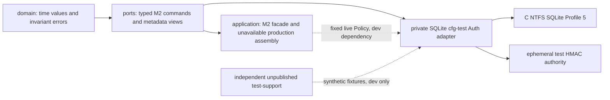

# P1-Memory M2 architecture and acceptance boundary

Accepted parent: c67e2d92701509bc2c1c1b189a0a6986df340b00 (M1 PASS supplied by owner).
M2 is private/local and awaiting Luna's concentrated independent review. Public main, MIT LICENSE,
PR #2, original tags and D: exFAT source are unchanged. No public push or deployment is authorized.

## Module dependency and actual execution



Arrows mean used-by layering for the first chain, not reverse compile imports: Ports imports Domain,
Application imports Ports/Domain, private SQLite implements Ports and invokes the fixed Application
policy. Normal Application/SQLite graphs exclude test-support. Domain still has no DB/network/model/
OS dependency. HMAC is an exact dev dependency used only by cfg(test) metadata signing code.

Production NoContentRuntime rejects ALL four M2 methods. It has no issuer, authenticated repository,
signer configuration or fixture injection. There is no REST server/MCP implementation in this delta.
The OpenAPI file is a reviewable wire draft, not a deployed capability. All concrete behavior below
is actual Rust + SQLite on synthetic metadata in controlled internal assembly.

## Profile, time and integrity

Profile 5 is fresh-only. Original SQL 0001–0004 is immutable; compiled Profile-5 Foundation text
renames M1's validity placeholders and adds the required revision_time circular deferred FK. The
0005 extension adds real temporal rows, read Grants and Conflict tables. Startup compares actual
schema with this compiled expectation, checks migration checksum, integrity and per-connection FKs.
V3/V4 checksums remain byte compatible and cross-profile files reject before migration.

See ADR-005 for the seven distinct clocks/counters and explicit Unknown/Certain/Possible semantics.
Already-normalized UTC boundary uncertainty and day/month/year precision survive; date/NL/timezone
parsing and raw source expressions are not implemented (raw text requires future protected Payload).
Wall-clock recorded_at is acceptance, not physical commit. as_of authenticates a tenant knowledge
sequence. Retrospective/future facts and old knowledge are separate dimensions.

Current integrity is checked BEFORE as_of and filters: current exists in the same Memory and is
latest; the chain is contiguous, parents/primary/source/time bindings exist. A poisoned current in
one authorized Space fails its query with Integrity, including history reads. The same transaction
feeds both validation and returned data. The tenant root must match its highest CommitRecord, and
Revision/parent/source knowledge order must be causal; future-source links are corruption, not
permission to leak later knowledge into old snapshots. It does not auto repair, and no old Revision can become
current merely because a later Revision does not match the requested filter or validity.

Snapshot rows expose immutable memory_version_at_revision; today's aggregate CAS counter stays
separate. Querying a past snapshot never silently changes that field after future writes.

## Read authorization and publication

```mermaid
sequenceDiagram
 participant C as Controlled identity / M2 facade
 participant A as Private SQLite
 participant DB as Authoritative SQLite
 C->>A: query scope + optional signed as_of / cursor
 A->>DB: BEGIN IMMEDIATE
 A->>DB: live identity, exact Grant, tenant/Space epochs
 A->>DB: current fences, full bounded row integrity
 A->>A: verify server MAC, tenant realm, query binding
 A->>DB: choose knowledge snapshot; filter authoritative candidates
 A->>A: materialize METADATA; deterministic order / page
 A->>DB: minimal read audit, no knowledge-seq allocation
 A->>DB: final live authority/time/fence check under writer lock
 A->>DB: COMMIT
 A-->>C: blocked envelope IDs and signed snapshot only
```

The final check is publication's linearization point. A read already holding SQLite's writer lock
can finish before a queued revoke; a read after a committed revoke denies even with old Context,
knowledge token or cursor. No process-only gate is relied upon. Actual Busy/queued-writer tests
exercise this lock. Final trusted-clock sampling retains Auth's conditional physical-commit cutoff;
public bearer expiry/streaming publication, power-loss and hostile host/VFS safety are unaccepted.

Current single-Memory uses memory.read, History uses memory.history, Current listing/filtering uses
memory.search. Write Grants grant none of these. Conflict mutation uses memory.revise; conflict
history uses memory.history. Bootstrap is unchanged and inaccessible to normal callers.

Only the private laboratory may inspect structural source_blocked placeholders. That is NOT a
production exception to P0's source_blocked refusal: production reads remain unavailable. Any
actual recorded deletion/invalidation, or a non-placeholder lifecycle state, blocks the entire
lab Space, including old snapshots and cursors. Absence of a fence is not a production source-validity
proof. Real deleted data, source replacement and content hydration are not implemented.

## Deterministic query and index contract

- Authoritative same-Space filtering: one/current/history, assertion kind, current supported state,
  Evidence ID, valid_at and explicit uncertainty policy. Cross-Space absent/existing targets cannot
  be distinguished by a successful/constraint chosen-ID insertion path.
- Stable ascending order: knowledge_seq, Memory UUID, Revision.number, Revision UUID. A same-batch
  tie fixture asserts nonzero results and deterministic page boundaries.
- Page size 1..100; 1000 Memories, 10000 Revisions/Evidence/Conflict decisions per Space. Budget
  overflow fails ResourceUnavailable without a fake-complete partial response. These are lab limits,
  not measured production capacity. The small authoritative implementation scans/materializes its
  bounded candidate set; throughput has not been benchmarked.
- Signed cursors bind scope, principal, realm, epochs, mode, filters, page size, knowledge snapshot
  and offset. Explicit as_of must agree. Future inserts cannot enter old pages; current fences win.
- Knowledge tokens bind tenant/realm/seq and reauthorize every use; they are not Grants. Real
  HMAC-SHA256 verify_slice is used, with a public RFC 4231 test vector and tamper tests. Test key
  loss/rotation invalidates tokens. No production signing backend, persistent rotation protocol,
  secure-memory guarantee or old-backup anti-rollback is claimed.
- RetrievalIndex extends the existing Index rebuild Port with candidate-only scope/generation/
  watermark/budget results. Its supplied backend is unavailable. External index flags are not proof:
  future callers must check authoritative registrations, auth/fences and requested watermark.
  Falling behind requires authoritative fallback or retryable unavailable, never stale completeness.
- FTS/BM25/graph/vector/temporal scoring are reserved and explicitly rejected. Index rebuild needs
  a new generation, snapshot + Outbox catch-up, tombstone replay, verified switch and erasure ACKs.
  No production term index or query-body input exists. The in-memory CJK diagnostic demonstrates
  Unicode61 whole-string behavior, trigram length limits and contentless vocabulary leakage. It is
  not evidence of production segmentation quality, recall or encrypted-index safety.

## Conflict

P0 Conflict identity links both same-Space Revision endpoints. Status is append-only decisions at
knowledge sequence, not a mutable fact winner. Existing endpoints, Evidence and Memory history are
retained through resolution/reopen. A resolution points to a Revision carrying both sources; reopen
requires a later Revision with new Evidence and a system action. Current Memory projections retain
conflict references for their lineage, even after further Memory revisions. Querying those refs
returns explicit historical decisions; no new fact implicitly closes a Conflict.

See ADR-006 for exact states, transactional CAS/replay/outbox and proof limits. There is no automatic
semantic detection or model-selected truth. Conflicts may be asserted even with shared sources or
non-overlapping validity; the core preserves a report, it does not certify logical contradiction.

## API and errors

Rust Ports are crates/ports/src/memory_m2.rs. JSON Schema and OpenAPI are under contracts/m2.
The draft's base64 is a future serialization of opaque MAC bytes; no HTTP serializer/auth server is
implemented. Profile selectors are shape markers, never runtime activation or permission. Synthetic
example tokens are explicitly shape-only and cannot pass the real verifier.

Integrity means corrupted current/relations: refuse without repair. AuthorizationDenied is uniform
for denied resources/unknown cross-scope refs. InvalidToken/InvalidCursor are authenticated request
errors. CasConflict/StateConflict/IdempotencyConflict preserve old state. UnsupportedQuery and
CapabilityUnavailable are never a plaintext fallback. No SQL diagnostics, original queries, secret
keys or content are emitted by the adapter. The wire error-to-status mapping remains draft-only.

## Remaining acceptance

Production identity/Grant services, Group inheritance, persistent signing keys, token TTL/rotation
operations, real source classification and content encryption, KeyVault/PayloadStore, content reads,
calendar/NL ingestion, semantic Conflict detection, actual index backends, erasure coordination,
backup rollback resistance, generation receipts, M2 process-kill/power-loss and hostile filesystem
races remain unaccepted. The new temporal/Conflict/audit mappings must join future deletion and
privacy/retention inventories before any real data admission. No new erasure exclusion is created.

The retained original Foundation process-kill and Auth process tests are not new M2 crash evidence.
Run full Rust suites with serialized independent fixture scheduling; internal race threads/processes
remain enabled. Existing Foundation's unbounded Barrier stability issue remains a separate harness
maintenance item; no original tests are removed. Schema shape tests, cryptographic vectors, CJK
experiments, worker helpers and actual SQLite business assertions are reported separately.
