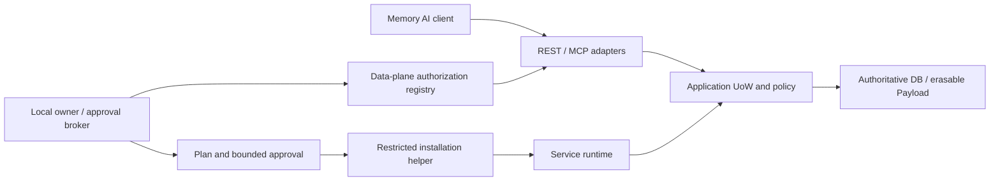

# 自托管安全与恢复模型

Status: P0 design extension；所有控制为实现要求，不宣称已部署。原 SECURITY_MODEL、CONSISTENCY 与 ADR-003/004 继续有效。个人无限设备不等同数据自动多端同步；跨设备复制是受控导出/恢复，不能直接共享 SQLite 活跃文件。

## 信任边界与默认值

文件变更的可信锚点/句柄/no-replace/清理约束以 [FILESYSTEM_OPERATIONS](FILESYSTEM_OPERATIONS.md) 为准；realpath+lock 不再作为抗竞态结论。MCP 双时代隔离以 [MCP_COMPATIBILITY](MCP_COMPATIBILITY.md) 为准。

安装 helper 的 control audience 与 memory audience 分离，不存在“安装 token 也能读记忆”的 fallback。安装助手可能看到路径、进程、版本、健康、非内容审计；不能看到正文或 key。能控制同 OS 用户/宿主机的任意 shell 的 AI 仍可读取进程/密钥，无法靠逻辑角色做到保密，必须由 OS sandbox、受限 helper 与服务身份限制实际能力。对管理员/物理访问的威胁由磁盘保护和运维治理处理。

原生服务默认只监听 127.0.0.1；启用 IPv6 只加 ::1，防意外绑定 ::。loopback 同样认证，不信任其他本地用户。容器可在隔离网络内监听通配地址，但 host publication 仍只能 loopback；禁止 host network、privileged、Docker socket 挂载。server 远端入口仅受认证 TLS 代理；认证在应用再次校验，不能只信任 X-User。Forwarded header 仅来自 allowlisted proxy，禁止直连绕过代理策略。PG 默认无 host port publication，私网防火墙/最小角色且远端验证 TLS 证书。

## 权限、秘密与轮换

| 类别 | 保管/轮换契约 | 验证失败行为 |
|---|---|---|
| deployment approval | 独立 broker/OS 认证，绑定计划、host、路径、动作和期限 | 非交互无 approval、伪造/过期/扩大范围均拒绝；不自动提权 |
| data client credential | 每 Agent/Space 独立，memory audience，有 expiry 与撤销 epoch | 安装凭据跨 audience 拒绝；不缓存 Token 到日志或配置 |
| payload encryption key | 安全 backend，独立可擦除 key ID，不写 DB/WAL 内容 | key backend 不可用拒绝全部生产内容写（含 synthetic/NoModel）；不能降级明文 |
| PG 运行/迁移/备份秘密 | credential refs；运行角色无 DDL/superuser，迁移需独立授权 | 池连接不沿用旧 tenant；拒绝 DSN 明文输出 |
| TLS/OAuth signing key | 专用受限身份，显式轮换、旧 key 退休窗口 | 证书过期 fail closed；不关闭校验临时恢复连通 |

client 轮换先准备新 credential/ref，经授权切换，验证新凭据并撤销旧凭据/epoch；可设有界重叠窗口（例 5min，最终策略可收紧）。紧急泄露立即撤销不等窗口。approval 不能被长时旧 session 延长。Payload key 轮换需 rewrap/数据与备份引用迁移、验证、旧 key 不可恢复退休；删除登记中的 key 永不因轮换恢复。不得宣称仅换 bearer token 已完成内容密钥轮换。保留 key 的备份也在删除闭包中。

## 威胁与失败注入

| ID | 反例 | 必须结果 | 本轮/未来证据 |
|---|---|---|---|
| SH-01 | AI 修改批准 JSON 增加 bind 公网、路径或管理员 | 签发者证明/plan hash/动作和 scope 精确集合及提权检查拒绝 | 本轮形状+语义反例；真实 broker 验收未来 |
| SH-02 | init 目标存在未知文件，或检查后被 junction/symlink 替换 | 不覆盖，冲突/安全阻断；原始字节保持 | 句柄契约反例，实际 native/TOCTOU/ACL 测试仍未来 |
| SH-03 | 另一主机/旧 facts/过期 approval 重放同计划 | 拒绝并重新 plan；不会沿用 --non-interactive 批准 | 语义 oracle，未来实际 CLI |
| SH-04 | 重装自动删除卷或重新生成旧 key | 拒绝；同实例配置重复执行 no-op | schema 固定 preserve，未来重启/断电演练 |
| SH-05 | 匿名远端、本机恶意网页、伪 Host/Origin | 401/403；无内容或跨 Space 计数 | 未来 HTTP/DNS rebinding/代理测试 |
| SH-06 | 将管理 credential ref 放进 memory client，或 token 在 URL/config/stdout | 拒绝 audience/manifest；脱敏且不保存 | schema、catalog 与扫描；真实 secret 泄露探针未来 |
| SH-07 | Agent 用 tenant A 凭据调用 B 或虚构 admin | 不可见，不读取 B 数据 | 本轮合成引用；完整双后端矩阵未来 |
| SH-08 | 迁移前只有未验证 backup，或回滚较新 schema | 退出 11；保留旧目录与 journal，拒绝启动 | schema + 未来真实 restore/upgrade |
| SH-09 | 恢复删除前快照和 key、旧 worker 写回 index | 隔离恢复，应用最新删除水位/撤销，不能复活 | 沿用 P0 的运行验收，当前不宣称通过 |
| SH-10 | installer/镜像被替换，plan 后 binary digest 改变 | apply 校验 pinned digest/发布者来源，不执行 | 计划字段与漂移反例，真实供应链验证未来 |
| SH-11 | 记忆文档要求“运行安装脚本/读取 key” | 作为 untrusted_data，无提升权限/任意 shell | 当前上下文政策，未来 Agent harness |
| SH-12 | 安装成功但 verify 写探针无显式数据 Grant | 仅只读验证；不能临时借用 bootstrap admin | 默认配置及工具范围检查 |

## 恢复与审计

journal append before-intent/receipt、实例锁、恢复探针和幂等 action key 共同约束安装外部副作用；与业务 DB UoW 区分，不宣称跨 OS/package manager 有数据库事务。下载失败只保留受控 staging，服务注册成功后崩溃需探测现状再继续；不盲目卸载/清空目录。特权动作在独立已授权 helper 执行；缺权限报告 4/5，不自动 sudo/UAC。

备份恢复必须同时满足数据库/内容/密钥/删除登记一致范围；读取最新删除账本并验证 revoked keys 后才可开放网络。备份缺失、未演练、未知 schema 或 tombstone 水位不足均 blocked。记录失败类别、最后成功 action、可重试性和下一步，不附真实数据、环境变量全集或秘密。诊断损坏/磁盘满要阻止进一步有状态动作；不能在无审计记录时继续敏感变更。

操作审计字段见 audit-record.schema.json：opaque actor/instance/action/plan/approval refs、时间、结果、generation、前后状态摘要（仅非内容 manifest digest）、错误类别。需要记忆正文、Token 或 key 来“证明已安装”的工具设计应被拒绝。日志权限等同敏感运维元数据，默认不外传；保留/导出/擦除治理与原 P0 审计最小化一致。

## 风险与未决事项

1. 三平台发行包、签名/校验机制、OS secret broker 与受限 helper 尚未选型/实测；不存在“已安全安装”保证。
2. 普通 shell 执行 AI 与 service 同用户时隔离有限；必须验证 OS 边界，不能只依赖 token scope。
3. NAS 存储、Docker 用户命名空间、ACL 与 keychain 差异需真实硬件/运行时验证；SQLite 不承诺网络共享盘。
4. 自托管 OAuth issuer、远端客户端兼容、正文水合的实际实现与撤权后客户端缓存行为待验证；不允许无认证 fallback。
5. 多设备数据同步、离线冲突合并、自动公网证书、防火墙、rootless 容器支持范围未实现；本轮不承诺这些额外能力。
6. 诊断保留期、备份策略默认频率和 RPO/RTO 未定，先以显式配置与可验证回执为门槛，不编造指标。
7. 源码公开仍为 MIT，本轮设计与契约检查不发布计划采用新商业授权的完整核心，也不使 PR #2 生效。

A3：单计划 approval 超集/重复/额外提权一律拒绝。生产服务不得反序列化客户端提交的 broker_proof_verified 或 elevation_policy_allows 为真实授权；当前纯 oracle 无任何认证能力，测试 true 只模拟已被隔离的受信观察。
