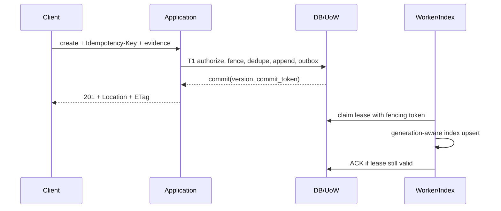
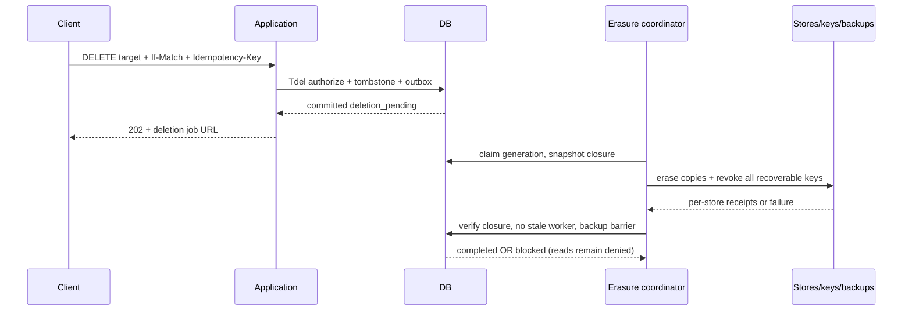

# CRUD 时序契约

读取：C→A 认证→权威快照检查 tenant/space、删除状态和授权 epoch→按 valid_at/as_of 选择 Revision→取 Evidence→同一已授权版本读取 Payload→响应。检索是先授权候选范围，再索引召回，再权威水合过滤；不能只过滤 top-k 后宣称完整，须有界补充召回并返回 partial 与水位；授权变化时重验或中止。分页 cursor 绑定 tenant/principal/query/policy epoch/快照，用服务端 MAC，失效返回 409；不在 cursor 放内容。

修改：C→A PATCH 新 assertion/evidence、If-Match、Idempotency-Key→T1 校验来源、父版本和 CAS→追加 Revision、Conflict（如存在矛盾）及事件→更新 current→COMMIT→200 新 ETag。旧版本始终可按知识时间访问，除非已删除/撤权。无来源或将 inference 自动转成事实返回 422。

删除 API 的 202 仅表示不可读栅栏已提交，不是擦除完成。GET deletion request 显示进度与失败类别，不泄露存储凭据。原始 Event 无普通 UPDATE/DELETE；敏感来源删除通过专门授权的 erasure 用例，不能以“不可变”拒绝真正删除。
